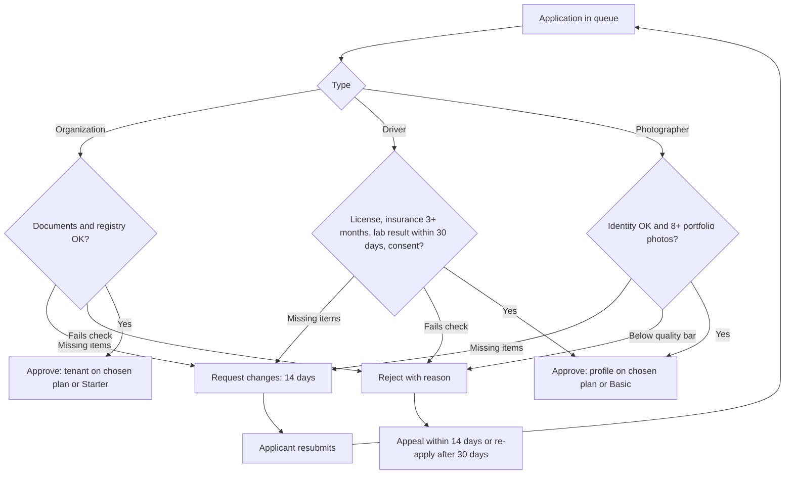

Surface: admin.trips-enjoy.com, staff only. Roles: Super admin, Operations, Finance (D-49).

## Registration

There is no public registration. A Super admin invites a new admin by email with a role; the link is valid 72 hours (D-50). The new admin sets a password (12+ characters) and enrolls an authenticator before the console opens.

## Approval

The inviting Super admin is the approver. Role changes and removals are audited.

## Role permissions

| Area | Super admin | Operations | Finance |
|---|---|---|---|
| Applications, appeals | Yes | Yes | View |
| Accounts (suspend, reinstate, reset) | Yes | Yes | View |
| Lab tests | Yes | Yes | No |
| Disputes | Yes | Yes | Refund decisions |
| Plans, prices, overrides | Yes | View | Yes |
| Coupons, abuse flags | Yes | Yes | View |
| Payouts, settlements, reconciliation | Yes | View | Yes |
| Markets, templates, feature flags | Yes | Templates | Markets (tax, prices) |
| Admin staff | Yes | No | No |
| Audit log | Yes | View | View |

## Flows

### UF-ADM-01. Sign in
Email and password, then the authenticator code. 5 failures lock the account for 15 minutes.
Rules: [FR-AUTH-04](/en/docs/srs/requirements/auth#fr-auth-04--role-specific-sign-in-methods), [FR-AUTH-05](/en/docs/srs/requirements/auth#fr-auth-05--sign-in-lockout).

### UF-ADM-02. Review an application
Actor: Operations or Super admin. Trigger: an application in the queue.
<Steps>
<Step>
Queue lists applications by type (organization, driver, photographer), age, overdue flag (over 2 working days), country.
</Step>
<Step>
Detail shows all fields, documents (opened from restricted storage, each open audited), and checks to record: identity, documents valid, insurance at least 3 months (drivers), lab result within 30 days (drivers), portfolio of 8+ photos (photographers), registry check (organizations).
</Step>
<Step>
Decision:
  - **Approve**: plan chosen or default assigned; organization tenant or supplier profile created; applicant notified.
  - **Request changes**: list items and a message in the applicant's language; 14-day due date.
  - **Reject**: reason code and message; applicant told about appeal (14 days) and re-apply (30 days).
</Step>
</Steps>
Rules: [FR-ONB-02](/en/docs/srs/requirements/onb#fr-onb-02--single-admin-queue) to [FR-ONB-05](/en/docs/srs/requirements/onb#fr-onb-05--rejection-appeal-and-re-application).

### UF-ADM-03. Decide an appeal
<Steps>
<Step>
Appeal shows the original decision, the statement and up to 5 files.
</Step>
<Step>
Uphold (application approved) or refuse (rejection final) within 5 working days.
</Step>
</Steps>
Rules: [FR-ONB-05](/en/docs/srs/requirements/onb#fr-onb-05--rejection-appeal-and-re-application).

### UF-ADM-04. Manage an account
<Steps>
<Step>
Search by name, email, phone, booking reference or organization.
</Step>
<Step>
Entity detail: roles, plan, status, bookings, deals, audit trail.
</Step>
<Step>
Suspend with a reason code; reinstate; reset credentials; early lift of a safety suspension needs a second admin.
</Step>
</Steps>
Rules: [FR-AUTH-08](/en/docs/srs/requirements/auth#fr-auth-08--suspension-and-reinstatement), [FR-ADM-01](/en/docs/srs/requirements/adm#fr-adm-01--account-administration).

### UF-ADM-05. Privacy requests
Queue of data-copy and deletion requests with due dates; data copies delivered within 30 days; deletions show the grace end date.
Rules: [FR-TRV-07](/en/docs/srs/requirements/trv#fr-trv-07--data-copy-and-deletion), [FR-AUTH-09](/en/docs/srs/requirements/auth#fr-auth-09--account-deletion-with-a-30-day-grace-period).

### UF-ADM-06. Request and review a lab test
<Steps>
<Step>
From a driver's profile, request a lab test: type (drug screen, medical fitness or both) and deadline (1 to 7 days, default 3).
</Step>
<Step>
The driver is paused at once; open deals end; upcoming assignments return to organizers.
</Step>
<Step>
Lab-test queue by state and deadline. Results from the partner lab or driver upload are reviewed: Passed (unpause) or Failed (stays paused; second failure in 12 months closes the account).
</Step>
<Step>
Missed deadline suspends the driver; over 30 days closes the account.
</Step>
</Steps>
Rules: [FR-ADM-09](/en/docs/srs/requirements/adm#fr-adm-09--lab-test-requests), [FR-DRV-03](/en/docs/srs/requirements/drv#fr-drv-03--lab-test-pause) to [FR-DRV-06](/en/docs/srs/requirements/drv#fr-drv-06--missed-deadline-suspension).

### UF-ADM-07. Plans and overrides
<Steps>
<Step>
Plan catalog per role: limits, features, trial length, prices per market and interval.
</Step>
<Step>
Overrides: one admin requests with reason and end date; a second admin approves; the owner is emailed; the plan reverts at the end date.
</Step>
</Steps>
Rules: [FR-SUB-01](/en/docs/srs/requirements/sub#fr-sub-01--plan-catalog), [FR-SUB-05](/en/docs/srs/requirements/sub#fr-sub-05--admin-overrides).

### UF-ADM-08. Coupons and abuse
Create platform coupons (optionally per market); revoke any coupon; review abuse flags within 2 working days (flags never block automatically).
Rules: [FR-ADM-06](/en/docs/srs/requirements/adm#fr-adm-06--platform-wide-coupons), [FR-ADM-07](/en/docs/srs/requirements/adm#fr-adm-07--abuse-flags), [FR-CPN-07](/en/docs/srs/requirements/cpn#fr-cpn-07--analytics-and-abuse-flags).

### UF-ADM-09. Deal audit
Deals list with filters; timeline of every offer; flag a deal with a reason, which can pause it.
Rules: [FR-NEG-06](/en/docs/srs/requirements/neg#fr-neg-06--deal-audit).

### UF-ADM-10. Disputes
<Steps>
<Step>
Queue with type, age, acknowledgment due (2 working days) and resolution due (10 working days).
</Step>
<Step>
Acknowledge, request information (answered within 5 working days), record outcome, issue a refund within or outside policy with a reason.
</Step>
</Steps>
Rules: [FR-ADM-04](/en/docs/srs/requirements/adm#fr-adm-04--dispute-outcomes-and-refunds), [FR-ADM-08](/en/docs/srs/requirements/adm#fr-adm-08--dispute-handling), [FR-PAY-04](/en/docs/srs/requirements/pay#fr-pay-04--refunds-outside-policy).

### UF-ADM-11. Finance operations
Actor: Finance or Super admin.
<Steps>
<Step>
Platform financial view by market and month.
</Step>
<Step>
Weekly payout run (Mondays 06:00): review, approve, submit; failed and held payouts listed with reasons.
</Step>
<Step>
Settlements tracker: open, awaiting payouts, disputed, closed.
</Step>
<Step>
Reconciliation exceptions (daily) and the 08:00 Cairo digest.
</Step>
<Step>
Invoices in finance review (numbering failures).
</Step>
</Steps>
Rules: [FR-ACC-03](/en/docs/srs/requirements/acc#fr-acc-03--supplier-earnings-and-payouts) to [FR-ACC-05](/en/docs/srs/requirements/acc#fr-acc-05--settlements), [FR-ACC-09](/en/docs/srs/requirements/acc#fr-acc-09--daily-reconciliation-and-finance-digest), [FR-ORG-07](/en/docs/srs/requirements/org#fr-org-07--b2b-and-b2c-invoices).

### UF-ADM-12. Payment escalations
Payments pending over 15 minutes appear in a queue with gateway status checks; admin resolves by confirming or failing after checking with the gateway.
Rules: [FR-PAY-08](/en/docs/srs/requirements/pay#fr-pay-08--payment-pending).

### UF-ADM-13. Configuration
Markets (currency, methods, tax, time zone, commission, status), notification templates by category, channel and language, feature flags. Every change audited.
Rules: [FR-ADM-03](/en/docs/srs/requirements/adm#fr-adm-03--configuration), [FR-MKT-01](/en/docs/srs/requirements/mkt#fr-mkt-01--market-configuration), [FR-NTF-04](/en/docs/srs/requirements/ntf#fr-ntf-04--versioned-templates).

### UF-ADM-14. Trip oversight and audit log
Trips across organizations with state filters; cancel only before In Progress. Audit log searchable by actor, action, target and date; read-only, kept 7 years.
Rules: [FR-TRIP-05](/en/docs/srs/requirements/trip#fr-trip-05--trip-lifecycle), [FR-ADM-05](/en/docs/srs/requirements/adm#fr-adm-05--immutable-audit-log).

### UF-ADM-15. Platform analytics and audit
Actor: super admin or Operations. Trigger: opening analytics or the audit log.
<Steps>
<Step>
Opens platform analytics: bookings, revenue and funnel views across markets, with data no more than 5 minutes stale.
</Step>
<Step>
Switches to the privacy view: aggregated figures only, no personal data, with the privacy note shown.
</Step>
<Step>
Drills into supplier analytics for driver and photographer performance views.
</Step>
<Step>
Exports a view; the export is ready within 15 minutes and expires after 7 days.
</Step>
<Step>
Searches the audit log by actor, action and object for the accountability trail.
</Step>
</Steps>
Edge cases: exports queue behind large ranges (status visible until ready).
Rules: [FR-ANL-02](/en/docs/srs/requirements/anl#fr-anl-02--supplier-analytics), [FR-ANL-03](/en/docs/srs/requirements/anl#fr-anl-03--admin-analytics), [FR-ANL-04](/en/docs/srs/requirements/anl#fr-anl-04--ranges-freshness-and-export), [FR-ANL-05](/en/docs/srs/requirements/anl#fr-anl-05--privacy-in-analytics).

### UF-ADM-16. Out-of-policy refund
Actor: admin with the finance role. Trigger: a refund the policy engine would not grant.
<Steps>
<Step>
Opens the booking or dispute and chooses an amount that differs from the policy computation.
</Step>
<Step>
Records a reason code; the confirmation names the policy delta.
</Step>
<Step>
Confirms; the refund is sent like any other and the ledger reversal carries the reason and an audit entry.
</Step>
</Steps>
Edge cases: refunds tied to a dispute follow the dispute's resolution state first.
Rules: [FR-PAY-04](/en/docs/srs/requirements/pay#fr-pay-04--refunds-outside-policy), [BRL-19](/en/docs/brd/requirements#7-business-rules), [FR-ADM-04](/en/docs/srs/requirements/adm#fr-adm-04--dispute-outcomes-and-refunds).
