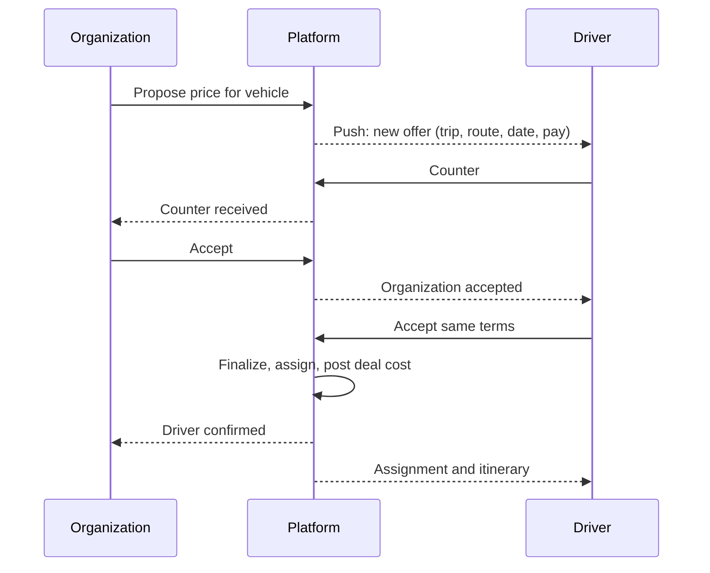

Surface: mobile app; the web is limited to documents and profile (D-86). Roles: platform driver, organization-owned driver.

## Registration: platform driver

| Field | Required | Notes |
|---|---|---|
| Full name | Yes | |
| Email and phone | Yes, both verified | D-20 |
| Password | Yes | |
| Country | Yes | Sets market and payout currency |
| National ID | Yes | Restricted storage |
| Driving license number and photo, expiry | Yes | |
| Uses own vehicle? | Yes | If yes: plate, model, year, seat count, registration, insurance valid 3+ more months |
| Service regions | Yes | |
| Lab-test consent | Yes | Recorded with text version |
| Initial lab result | Yes | Dated within the last 30 days |
| Background-check consent | Where the market's legal review allows | |
| Plan choice | No | Basic if none (D-78); no charge before approval |

## Registration: organization-owned driver

Invited by an organization by SMS or email (valid 7 days). Fields: name, phone (verified), country, license. No admin approval; accepted on assignment.

## Approval: platform driver

Admin reviews identity, license, vehicle documents, insurance and lab result ([Admin Console](/en/docs/user-flows/admin), [UF-ADM-02](/en/docs/user-flows/admin#uf-adm-02-review-an-application)). Approve, request changes or reject. On approval the driver lands on home with the plan, and appears in the platform driver pool.

## Flows

### UF-DRV-01. Register and apply
<Steps>
<Step>
Account step, verification of both contacts, details, vehicle, documents, lab consent and result, plan.
</Step>
<Step>
Submit; status page shows Pending Review and the 2-working-day target.
</Step>
<Step>
Changes requested: the status page lists items, due date, and an "ask for 7 more days" action (once).
</Step>
</Steps>
Rules: [FR-ONB-01](/en/docs/srs/requirements/onb#fr-onb-01--application-and-supplier-access), [FR-ONB-07](/en/docs/srs/requirements/onb#fr-onb-07--driver-vehicle-and-insurance-details), [FR-ONB-08](/en/docs/srs/requirements/onb#fr-onb-08--lab-consent-and-initial-result).

### UF-DRV-02. Set availability and profile
Mark available or unavailable dates and ranges (no weekly rules). Edit rates, regions, vehicle and documents; expiring documents trigger reminders.
Rules: [FR-DRV-08](/en/docs/srs/requirements/drv#fr-drv-08--driver-availability).

### UF-DRV-03. Respond to a deal
<Steps>
<Step>
Offers inbox: new offers, counters, expiring soon (72 hours after the last counter).
</Step>
<Step>
Offer detail: organization, trip, route, date, vehicle, pay before any action.
</Step>
<Step>
Accept, counter with a new price and note, or reject.
</Step>
<Step>
When both sides accept the same terms, the deal locks and the assignment appears in Trips.
</Step>
</Steps>
Edge cases: conflict with an existing assignment on the date (warning); plan's monthly booking limit reached on finalization (upgrade prompt).
Rules: [FR-DRV-02](/en/docs/srs/requirements/drv#fr-drv-02--deal-responses), [FR-NEG-01](/en/docs/srs/requirements/neg#fr-neg-01--deal-proposal) to [FR-NEG-04](/en/docs/srs/requirements/neg#fr-neg-04--rejection), [FR-STF-06](/en/docs/srs/requirements/stf#fr-stf-06--deal-request-visibility).

### UF-DRV-04. Run an assigned vehicle
<Steps>
<Step>
Trips list: upcoming assignments with organization, vehicle, pickup time.
</Step>
<Step>
Pre-trip checklist; contact the moderator and operations.
</Step>
<Step>
Start route: GPS shared every 5 to 10 seconds while the trip is In Progress, buffered up to 60 minutes offline.
</Step>
<Step>
End of trip: route closes; location sharing stops.
</Step>
</Steps>
Rules: [FR-TRK-02](/en/docs/srs/requirements/trk#fr-trk-02--location-collection), [FR-TRK-06](/en/docs/srs/requirements/trk#fr-trk-06--end-of-tracking).

### UF-DRV-05. Lab test requested
Trigger: an admin requests a lab test.
<Steps>
<Step>
The app opens on the lab-test gate. Only four actions work: book the lab, upload the result, contact support, sign out.
</Step>
<Step>
Book a slot at a partner lab (free); see the deadline countdown.
</Step>
<Step>
The partner sends the result, or the driver uploads it.
</Step>
<Step>
Passed: the app unlocks. Failed: stays paused for admin handling. Missed: suspended; closed after 30 days.
</Step>
<Step>
Upcoming trips go back to their organizers; completed trips are paid, uncompleted ones held.
</Step>
</Steps>
Rules: [FR-DRV-03](/en/docs/srs/requirements/drv#fr-drv-03--lab-test-pause) to [FR-DRV-06](/en/docs/srs/requirements/drv#fr-drv-06--missed-deadline-suspension), [BRL-16](/en/docs/brd/requirements#7-business-rules), [BRL-17](/en/docs/brd/requirements#7-business-rules).

### UF-DRV-06. Earnings and payouts
Earnings by trip, statements, weekly payouts on Mondays; commission shown as a ledger line without a printed rate until [OD-15](/en/docs/brd/compliance#11-open-decisions) is set; negative balances carried forward.
Rules: [FR-DRV-07](/en/docs/srs/requirements/drv#fr-drv-07--earnings-and-payouts), [FR-ACC-03](/en/docs/srs/requirements/acc#fr-acc-03--supplier-earnings-and-payouts).

### UF-DRV-07. Coupons
Create coupons that apply only to bookings where the driver is assigned, within the plan's count.
Rules: [FR-CPN-01](/en/docs/srs/requirements/cpn#fr-cpn-01--creator-scope), [FR-CPN-08](/en/docs/srs/requirements/cpn#fr-cpn-08--coupon-count-by-plan).

### UF-DRV-08. Plan
Current plan, monthly booking usage, visibility level, upgrade or downgrade through the browser gateway page.
Rules: [FR-SUB-02](/en/docs/srs/requirements/sub#fr-sub-02--feature-gates), [FR-SUB-04](/en/docs/srs/requirements/sub#fr-sub-04--upgrade-downgrade-and-cancellation).

### UF-DRV-09. Organization-owned driver home
Sees only that organization's trips and assignments; no offers inbox, no plan screen, no coupons.
Rules: [FR-DRV-01](/en/docs/srs/requirements/drv#fr-drv-01--driver-work-area), [BRL-05](/en/docs/brd/requirements#7-business-rules).

### UF-DRV-10. Support
Contact support from any state, including the lab-test gate; tickets show status.
Rules: [FR-DRV-03](/en/docs/srs/requirements/drv#fr-drv-03--lab-test-pause).
