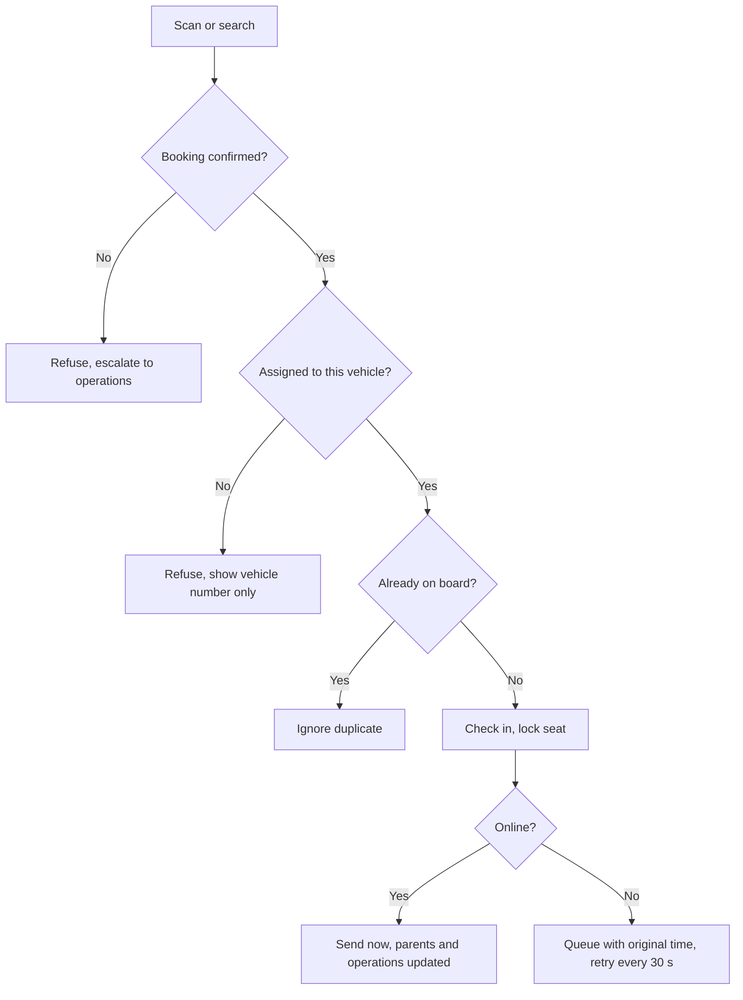

Surface: installable web app on phones. Role: vehicle moderator.

## Registration

No self-registration. The organization assigns a moderator to one vehicle on one trip with name and phone (D-107). The moderator receives an SMS link to install the app and a staff code.

## Approval

The assignment by the organization is the approval. Access lasts until 24 hours after the trip ends, on one device at a time (D-108). Replacing the moderator ends access at once. The moderator's plan rule is [OD-06](/en/docs/brd/compliance#11-open-decisions).

## Flows

### UF-MOD-01. Install and first open
<Steps>
<Step>
Opens the SMS link; adds the app to the home screen.
</Step>
<Step>
Permission primer: location (for check-in location and tracking fallback), camera (scanning), notifications.
</Step>
<Step>
Opens to the vehicle view.
</Step>
</Steps>
Rules: [FR-MOD-04](/en/docs/srs/requirements/mod#fr-mod-04--installable-app).

### UF-MOD-02. Sign in
Phone and staff code. Signing in on a second device ends the first session. No assignment, or an expired assignment, shows "no active vehicle".
Rules: [FR-MOD-05](/en/docs/srs/requirements/mod#fr-mod-05--moderator-sign-in).

### UF-MOD-03. Vehicle home and manifest
Vehicle label, trip, departure time, pickup point, driver contact, operations contact; manifest of passengers with seat and status (not boarded, on board, off vehicle); occupancy counter.
Rules: [FR-MOD-01](/en/docs/srs/requirements/mod#fr-mod-01--vehicle-scoped-access), [FR-CHK-07](/en/docs/srs/requirements/chk#fr-chk-07--occupancy).

### UF-MOD-04. Check in a passenger
<Steps>
<Step>
Scan the passenger's boarding code, or search the manifest by name.
</Step>
<Step>
Results:
  - **Checked in**: seat confirmed; event recorded with time and location where permitted.
  - **Wrong vehicle**: refused; shows "vehicle N" only.
  - **Not found or not confirmed**: refused; escalate to operations.
  - **Already on board**: duplicate ignored.
  - **Queued**: offline; will sync.
</Step>
</Steps>
Rules: [FR-CHK-01](/en/docs/srs/requirements/chk#fr-chk-01--check-in-at-boarding) to [FR-CHK-03](/en/docs/srs/requirements/chk#fr-chk-03--event-record), [BRL-09](/en/docs/brd/requirements#7-business-rules).

### UF-MOD-05. Check out at a stop or destination
Select the stop; check passengers out individually or all at once; a passenger checked out at a stop can re-board and be checked in again (proposed).
Rules: [FR-CHK-04](/en/docs/srs/requirements/chk#fr-chk-04--check-out-at-stops).

### UF-MOD-06. Offline queue
Banner shows offline state and the number of queued events; warning at 800; maximum 1,000; events send in order with original times when the connection returns.
Rules: [FR-CHK-05](/en/docs/srs/requirements/chk#fr-chk-05--offline-queue).

### UF-MOD-07. Report an incident
Category (safety, medical, vehicle fault, lost traveler, conduct, other), description, photo, location; operations sees it at once.
Rules: [FR-CHK-06](/en/docs/srs/requirements/chk#fr-chk-06--incident-reporting).

### UF-MOD-08. End-of-trip report and access end
<Steps>
<Step>
Enter final headcount; if it differs from the checked-in count, a reason is required; add notes; submit (read-only after).
</Step>
<Step>
Access ends 24 hours after the trip ends, or at once on replacement, with an "access ended" screen.
</Step>
</Steps>
Rules: [FR-MOD-02](/en/docs/srs/requirements/mod#fr-mod-02--end-of-trip-report), [FR-MOD-03](/en/docs/srs/requirements/mod#fr-mod-03--access-revocation), [FR-MOD-06](/en/docs/srs/requirements/mod#fr-mod-06--report-lock).
