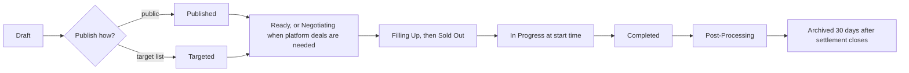

Surface: business.trips-enjoy.com (web only for registration; the dashboard is responsive). Roles: organization owner, employee.

## Registration

| Field | Required | Notes |
|---|---|---|
| Owner full name | Yes | Becomes the owner account |
| Owner email and phone | Yes, both verified | D-20 |
| Password | Yes | Second factor set up on first sign-in |
| Country | Yes | Sets the organization's market, currency, tax rules and time zone |
| Legal name and trade name | Yes | Arabic and English |
| Commercial registration number | Yes | |
| Tax number | Yes where the market requires it | |
| Registration documents | Yes | Commercial registration, tax certificate; PDF, JPG or PNG up to 10 MB |
| Business address and category | Yes | Category: school, corporate, religious, tourism, event, other |
| Billing contact | Yes | Email for invoices |
| Plan choice | No | Shown without charge; Starter if none (D-77, D-24) |

## Approval

<Steps>
<Step>
Application enters the admin queue; the applicant sees "under review" with the 2-working-day target.
</Step>
<Step>
Admin checks documents and registry details (manual in phase 1).
</Step>
<Step>
Decision: approve (tenant created on the chosen plan or Starter, owner invited); request changes (14 days, reminder day 7, one 7-day extension); reject with reason (appeal within 14 days, re-apply after 30 days).
</Step>
<Step>
Every decision notifies the owner in their language.
</Step>
</Steps>

## Flows

### UF-ORG-01. First sign-in and setup
<Steps>
<Step>
Owner signs in with email and password; sets up an SMS or authenticator second factor.
</Step>
<Step>
Setup checklist: profile and logo, time zone (defaults from market), invoice settings, first vehicle type, first vehicle, invite staff, onboard own drivers and photographers, payout bank details.
</Step>
<Step>
Empty-state home shows the checklist and plan usage.
</Step>
</Steps>
Rules: [FR-ORG-02](/en/docs/srs/requirements/org#fr-org-02--tenant-setup-on-approval), [FR-EMP-06](/en/docs/srs/requirements/emp#fr-emp-06--invitation-and-first-sign-in).

### UF-ORG-02. Switch organization
<Steps>
<Step>
A staff member whose email is listed by several organizations sees the organization switcher.
</Step>
<Step>
Choosing one changes the workspace; data from the other is never shown.
</Step>
</Steps>
Rules: [FR-AUTH-07](/en/docs/srs/requirements/auth#fr-auth-07--staff-access-to-several-organizations), [BRL-01](/en/docs/brd/requirements#7-business-rules).

### UF-ORG-03. Invite and manage employees
<Steps>
<Step>
Invite by email with a permission template (Operations, Finance, Support, Manager) or custom permissions across trips, bookings, operations, accounting, coupons, employees, fleet, subscription, integrations, analytics.
</Step>
<Step>
Link valid 7 days; on first sign-in the employee sets a password and second factor.
</Step>
<Step>
Change permissions (history shows actor, time, before and after); suspend or remove (access ends at once).
</Step>
</Steps>
Edge case: the plan's employee limit is reached; the invite is blocked with an upgrade prompt.
Rules: [FR-EMP-01](/en/docs/srs/requirements/emp#fr-emp-01--permission-sets) to [FR-EMP-06](/en/docs/srs/requirements/emp#fr-emp-06--invitation-and-first-sign-in).

### UF-ORG-04. Fleet
<Steps>
<Step>
Vehicle types: name, seat grid, labeled seats, accessible and blocked seats; archive.
</Step>
<Step>
Vehicles: plate, model, year, type, seats (must match), registration validity.
</Step>
</Steps>
Rules: [FR-FLT-01](/en/docs/srs/requirements/flt#fr-flt-01--reusable-vehicle-types), [FR-FLT-02](/en/docs/srs/requirements/flt#fr-flt-02--vehicle-registry), [FR-FLT-06](/en/docs/srs/requirements/flt#fr-flt-06--archiving-vehicle-types).

### UF-ORG-05. Own drivers and photographers
<Steps>
<Step>
Invite by SMS or email (valid 7 days) with name, phone, country; license for drivers.
</Step>
<Step>
They appear only in this organization's lists and are accepted on assignment.
</Step>
<Step>
Removing one releases their future assignments and alerts operations.
</Step>
</Steps>
Rules: [FR-ORG-03](/en/docs/srs/requirements/org#fr-org-03--organization-owned-drivers-and-photographers), [BRL-05](/en/docs/brd/requirements#7-business-rules).

### UF-ORG-06. Create a trip (wizard)
<Steps>
<Step>
**Basics**: title, description, category, cover image, language.
</Step>
<Step>
**Schedule and route**: start and end, time zone, pickup points, stops, destination on a map.
</Step>
<Step>
**Vehicles**: add vehicles up to the plan limit, each with a vehicle type and label.
</Step>
<Step>
**Staffing**: per vehicle, driver (own, or platform through a deal on Growth and Enterprise) and moderator (with phone); trip photographer (own or platform).
</Step>
<Step>
**Programs**: add programs with pricing model, price or tiers, type flags, capacity; up to the plan limit.
</Step>
<Step>
**Seating**: company-assigned or self-select (Growth and Enterprise); priority window for Explorer and VIP.
</Step>
<Step>
**Pricing and capacity**: base price in the market currency; child tracking switch (Growth and Enterprise).
</Step>
<Step>
**Publish**: save draft, publish publicly, or publish to a target list.
</Step>
</Steps>
Edge cases: missing step blocks publishing and names the step; monthly active-trip limit reached; market not live.
Rules: [FR-TRIP-01](/en/docs/srs/requirements/trip#fr-trip-01--trip-creation-wizard) to [FR-TRIP-03](/en/docs/srs/requirements/trip#fr-trip-03--multi-vehicle-trips), [FR-TRIP-07](/en/docs/srs/requirements/trip#fr-trip-07--active-trip-limit), [FR-PRG-01](/en/docs/srs/requirements/prg#fr-prg-01--pricing-models) to [FR-PRG-06](/en/docs/srs/requirements/prg#fr-prg-06--program-count-limit), [FR-ORG-05](/en/docs/srs/requirements/org#fr-org-05--seat-self-selection-setting), [FR-SEAT-07](/en/docs/srs/requirements/seat#fr-seat-07--self-selection-by-plan).

The full state machine, including cancellation and remedy paths, is the [trip lifecycle workflow](/en/docs/workflows/trip-lifecycle).

### UF-ORG-07. Hire a platform supplier (deal)
<Steps>
<Step>
Search platform drivers or photographers by date availability, region, rating badge and price.
</Step>
<Step>
Propose a price for a vehicle or the trip; the supplier sees trip, route, date, vehicle and pay.
</Step>
<Step>
Counter back and forth with no round limit; each offer expires 72 hours after the last counter.
</Step>
<Step>
Accept: when both sides accept the same terms, the deal is finalized and the supplier assigned.
</Step>
<Step>
Rejected or expired: the slot reopens for another supplier.
</Step>
</Steps>
Rules: [FR-NEG-01](/en/docs/srs/requirements/neg#fr-neg-01--deal-proposal) to [FR-NEG-07](/en/docs/srs/requirements/neg#fr-neg-07--negotiation-by-plan), [BRL-04](/en/docs/brd/requirements#7-business-rules), [BRL-26](/en/docs/brd/requirements#7-business-rules).

### UF-ORG-08. Move a trip to Ready
<Steps>
<Step>
Staffing board shows each vehicle's driver and moderator status and each open deal.
</Step>
<Step>
Ready is refused with the list of gaps until every vehicle is staffed and every deal finalized.
</Step>
<Step>
A staffing-gap email arrives 48 hours before departure; reassignment is allowed until 24 hours before.
</Step>
</Steps>
Rules: [FR-STF-03](/en/docs/srs/requirements/stf#fr-stf-03--ready-gate), [FR-STF-07](/en/docs/srs/requirements/stf#fr-stf-07--reassignment-deadline), [BRL-07](/en/docs/brd/requirements#7-business-rules).

### UF-ORG-09. Manage bookings and seats
<Steps>
<Step>
Bookings list with filters by state, vehicle and program; passenger roster.
</Step>
<Step>
Booking detail: passengers, seats, programs, totals, payments, refunds, notes.
</Step>
<Step>
Seat map in assign mode: drag passengers to seats; conflicts refused.
</Step>
<Step>
Handle cancellation requests after the policy cut-off within 2 working days.
</Step>
</Steps>
Rules: [FR-SEAT-06](/en/docs/srs/requirements/seat#fr-seat-06--staff-seat-assignment), [FR-BKG-04](/en/docs/srs/requirements/bkg#fr-bkg-04--traveler-cancellation-and-refund).

### UF-ORG-10. Change a trip after bookings
<Steps>
<Step>
Edit programs, vehicles, seat mode or times.
</Step>
<Step>
If confirmed bookings are affected, the system lists them and requires sending remedy offers before saving.
</Step>
<Step>
Travelers have 7 days to choose; unresolved cases go to admin.
</Step>
</Steps>
Rules: [FR-TRIP-06](/en/docs/srs/requirements/trip#fr-trip-06--changes-that-affect-confirmed-bookings), [BRL-24](/en/docs/brd/requirements#7-business-rules).

### UF-ORG-11. Cancel a trip
<Steps>
<Step>
Cancel with a reason before the trip starts; the preview shows bookings and the full refund total.
</Step>
<Step>
All confirmed bookings are cancelled and refunded in full; suppliers and travelers are notified.
</Step>
<Step>
In Progress trips cannot be cancelled; the screen points to incident handling.
</Step>
</Steps>
Rules: [FR-BKG-06](/en/docs/srs/requirements/bkg#fr-bkg-06--organization-cancellation-of-a-trip), [BRL-30](/en/docs/brd/requirements#7-business-rules).

### UF-ORG-12. Live operations
<Steps>
<Step>
Trip command view on departure day: vehicles on a map, occupancy per vehicle, check-ins as they happen, incidents in real time.
</Step>
<Step>
Look up any passenger to see their vehicle and status.
</Step>
<Step>
Review end-of-trip reports and add a note.
</Step>
</Steps>
Rules: [FR-TRK-01](/en/docs/srs/requirements/trk#fr-trk-01--live-vehicle-location), [FR-TRK-03](/en/docs/srs/requirements/trk#fr-trk-03--passenger-vehicle-view), [FR-CHK-06](/en/docs/srs/requirements/chk#fr-chk-06--incident-reporting), [FR-CHK-07](/en/docs/srs/requirements/chk#fr-chk-07--occupancy), [FR-MOD-06](/en/docs/srs/requirements/mod#fr-mod-06--report-lock).

### UF-ORG-13. Coupons
Create, pause, resume and revoke coupons for own trips; per-coupon analytics with 7, 30 and 90-day presets; count limited by plan (active and paused).
Rules: [FR-CPN-01](/en/docs/srs/requirements/cpn#fr-cpn-01--creator-scope), [FR-CPN-07](/en/docs/srs/requirements/cpn#fr-cpn-07--analytics-and-abuse-flags), [FR-CPN-08](/en/docs/srs/requirements/cpn#fr-cpn-08--coupon-count-by-plan).

### UF-ORG-14. Invoices
<Steps>
<Step>
B2C invoices issue automatically on confirmation; B2B when the buyer gave a tax number.
</Step>
<Step>
Issue a manual invoice for a group or corporate buyer.
</Step>
<Step>
Corrections by credit note only.
</Step>
</Steps>
Rules: [FR-ORG-07](/en/docs/srs/requirements/org#fr-org-07--b2b-and-b2c-invoices), [BRL-28](/en/docs/brd/requirements#7-business-rules).

### UF-ORG-15. Accounting and settlements
<Steps>
<Step>
Trip accounting: base revenue, program revenue, coupon impact, supplier costs, commission, gateway fees.
</Step>
<Step>
Ledger browser with filters; exports by plan.
</Step>
<Step>
Settlements: one per completed trip, with lines per party, status, and closure when paid and dispute-free.
</Step>
</Steps>
Rules: [FR-ACC-02](/en/docs/srs/requirements/acc#fr-acc-02--organization-accounting-per-trip), [FR-ACC-05](/en/docs/srs/requirements/acc#fr-acc-05--settlements) to [FR-ACC-07](/en/docs/srs/requirements/acc#fr-acc-07--reconciled-exports).

### UF-ORG-16. Analytics
Trip, page, customer and provider analytics (Growth basic, Enterprise full), date presets and export.
Rules: [FR-ANL-01](/en/docs/srs/requirements/anl#fr-anl-01--organization-analytics), [FR-ANL-04](/en/docs/srs/requirements/anl#fr-anl-04--ranges-freshness-and-export).

### UF-ORG-17. CRM and webhooks
<Steps>
<Step>
Connect a CRM; register webhook endpoints and choose events.
</Step>
<Step>
See deliveries, failures and replay any delivery for 7 days; rotate the secret (old secret valid 24 hours).
</Step>
</Steps>
Rules: [FR-ORG-06](/en/docs/srs/requirements/org#fr-org-06--crm-and-webhooks).

### UF-ORG-18. Plan and billing
<Steps>
<Step>
Current plan, usage against limits, renewal date, invoices.
</Step>
<Step>
Upgrade (at once, prorated) or downgrade (cycle end); cancel.
</Step>
<Step>
Grace banner during failed renewals with retry dates.
</Step>
</Steps>
Rules: [FR-SUB-02](/en/docs/srs/requirements/sub#fr-sub-02--feature-gates) to [FR-SUB-04](/en/docs/srs/requirements/sub#fr-sub-04--upgrade-downgrade-and-cancellation), [FR-SUB-08](/en/docs/srs/requirements/sub#fr-sub-08--dunning).

### UF-ORG-19. Child-safety reports
Staff file a report about a child passenger; the case routes to the escalation contact; the list shows status.
Rules: [FR-PAR-07](/en/docs/srs/requirements/par#fr-par-07--child-safety-reporting).

### UF-ORG-20. Branding (Enterprise)
Logo and colors applied to public trip pages, emails and invoices.
Rules: [FR-ORG-08](/en/docs/srs/requirements/org#fr-org-08--custom-branding).

### UF-ORG-21. Employee first sign-in
Actor: employee. Trigger: opening the invitation link within its 7-day life.
<Steps>
<Step>
Sets a password from the invitation email; the link dies after 7 days and the owner can resend.
</Step>
<Step>
Enables a second factor (SMS or authenticator); organization staff enter it at every sign-in.
</Step>
<Step>
Lands in the organization workspace with only the permissions the owner granted.
</Step>
</Steps>
Edge cases: expired link (owner resends); lost second factor (owner resets through support).
Rules: [FR-ORG-03](/en/docs/srs/requirements/org#fr-org-03--organization-owned-drivers-and-photographers), [FR-EMP-02](/en/docs/srs/requirements/emp#fr-emp-02--permission-changes-are-audited), [FR-AUTH-04](/en/docs/srs/requirements/auth#fr-auth-04--role-specific-sign-in-methods).

### UF-ORG-22. Coupon lifecycle
Actor: organization owner or employee with the coupon permission. Trigger: creating a campaign.
<Steps>
<Step>
Creates the coupon: type, stackability, window, usage limits, minimum spend; it activates at once or at the window start.
</Step>
<Step>
Watches usage on the coupon list; pauses and resumes at any time.
</Step>
<Step>
Revokes with a reason when the campaign ends; revoked codes fail with not found.
</Step>
<Step>
Refunds reverse redemptions: usage counts fall back, and an Exhausted coupon returns to Active if its window is still open.
</Step>
<Step>
Suspicious redemptions raise an abuse flag for admin review within 2 working days.
</Step>
</Steps>
Edge cases: exhaustion mid-checkout (the code fails cleanly at Summary); per-user limits freed by refunds.
Rules: [FR-CPN-04](/en/docs/srs/requirements/cpn#fr-cpn-04--coupon-types), [FR-CPN-05](/en/docs/srs/requirements/cpn#fr-cpn-05--lifecycle-and-controls), [FR-CPN-06](/en/docs/srs/requirements/cpn#fr-cpn-06--redemption-and-reversal), [FR-CPN-07](/en/docs/srs/requirements/cpn#fr-cpn-07--analytics-and-abuse-flags).

### UF-ORG-23. Fleet mid-lifecycle
Actor: organization owner or fleet manager. Trigger: changing the fleet while trips exist.
<Steps>
<Step>
Adds a vehicle with its type and label; the seat map derives from the vehicle type's rows and layout.
</Step>
<Step>
Assigns vehicles to trips up to the per-trip limit; labels flow through to published trip pages and tickets.
</Step>
<Step>
Removes a vehicle only when no future bookings depend on it; otherwise the removal names the blocking trips.
</Step>
</Steps>
Edge cases: seat mode changes on a trip with bookings follow the trip-change remedy rules.
Rules: [FR-ORG-04](/en/docs/srs/requirements/org#fr-org-04--fleet-registration), [FR-FLT-03](/en/docs/srs/requirements/flt#fr-flt-03--vehicle-limit-per-trip), [FR-FLT-04](/en/docs/srs/requirements/flt#fr-flt-04--seat-map-from-vehicle-type), [FR-FLT-05](/en/docs/srs/requirements/flt#fr-flt-05--vehicle-removal-after-bookings), [FR-SEAT-01](/en/docs/srs/requirements/seat#fr-seat-01--company-assigned-by-default).

### UF-ORG-24. Consume the public API
Actor: organization developer. Trigger: integrating bookings, trips or webhooks with external systems.
<Steps>
<Step>
Creates an API key from organization settings; the key carries the organization's plan limits.
</Step>
<Step>
Signs requests with the key; reads trips, bookings and availability through the public endpoints.
</Step>
<Step>
Registers a webhook endpoint and verifies the signature; deliveries retry 5 times over 24 hours and remain replayable for 7 days.
</Step>
<Step>
Rotates the signing secret with a 24-hour overlap so in-flight deliveries keep validating.
</Step>
</Steps>
Edge cases: secret rotation (old secret valid 24 hours); missed events (replay from the event log).
Rules: [FR-API-01](/en/docs/srs/requirements/api#fr-api-01--public-api), [FR-ORG-06](/en/docs/srs/requirements/org#fr-org-06--crm-and-webhooks).
