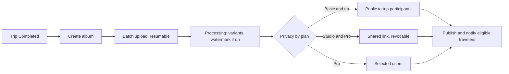

Surface: responsive web in phase 1, plus mobile (D-86). Roles: platform photographer, organization-owned photographer.

## Registration: platform photographer

| Field | Required | Notes |
|---|---|---|
| Full name | Yes | |
| Email and phone | Yes, both verified | D-20 |
| Password | Yes | |
| Country | Yes | |
| ID document | Yes | Restricted storage |
| Portfolio | Yes, at least 8 photos | JPEG, PNG or HEIC, 25 MB each |
| Bio, equipment, service regions | Yes | |
| Rates | Yes | In the market currency |
| Plan choice | No | Basic if none (D-78) |

## Registration: organization-owned photographer

Invited by an organization by SMS or email (valid 7 days): name, phone, country. No admin approval; accepted on assignment.

## Approval: platform photographer

Admin checks identity and portfolio quality ([Admin Console](/en/docs/user-flows/admin), [UF-ADM-02](/en/docs/user-flows/admin#uf-adm-02-review-an-application)). Approve, request changes or reject. On approval the photographer becomes discoverable by Growth and Enterprise organizations. Lab tests do not apply to photographers.

## Flows

### UF-PHO-01. Register and apply
Account, verification, profile, portfolio upload (minimum 8), rates, plan; submit; status page as in [UF-DRV-01](/en/docs/user-flows/driver#uf-drv-01-register-and-apply).
Rules: [FR-ONB-06](/en/docs/srs/requirements/onb#fr-onb-06--photographer-portfolio-minimum).

### UF-PHO-02. Portfolio, profile and availability
Manage portfolio within the plan allowance (10, 50, unlimited); visibility and badge follow the plan; mark available and unavailable dates and ranges.
Rules: [FR-PHO-01](/en/docs/srs/requirements/pho#fr-pho-01--portfolio), [FR-PHO-02](/en/docs/srs/requirements/pho#fr-pho-02--rates-and-availability), [FR-PHO-06](/en/docs/srs/requirements/pho#fr-pho-06--visibility-and-badge).

### UF-PHO-03. Respond to a deal
Same negotiation as drivers ([Driver App](/en/docs/user-flows/driver), [UF-DRV-03](/en/docs/user-flows/driver#uf-drv-03-respond-to-a-deal)), for a whole trip rather than a vehicle. Deals for unavailable dates are refused.
Rules: [FR-NEG-01](/en/docs/srs/requirements/neg#fr-neg-01--deal-proposal) to [FR-NEG-04](/en/docs/srs/requirements/neg#fr-neg-04--rejection), [FR-STF-02](/en/docs/srs/requirements/stf#fr-stf-02--photographer-tracks).

### UF-PHO-04. Assigned trip brief
Trip, dates, route and stops, organization contact, programs to cover, expected album delivery window (14 days after completion).
Rules: [FR-MED-01](/en/docs/srs/requirements/med#fr-med-01--album-creation-window).

### UF-PHO-05. Create and upload an album
<Steps>
<Step>
After the trip is Completed, create an album (within 14 days; count per plan).
</Step>
<Step>
Upload in batches directly to storage; interrupted batches resume.
</Step>
<Step>
Processing makes thumbnail, medium, large and watermarked copies; EXIF is stripped.
</Step>
</Steps>
Rules: [FR-MED-01](/en/docs/srs/requirements/med#fr-med-01--album-creation-window), [FR-MED-02](/en/docs/srs/requirements/med#fr-med-02--resumable-batch-upload), [FR-MED-08](/en/docs/srs/requirements/med#fr-med-08--albums-per-trip-by-plan).

### UF-PHO-06. Privacy and sharing
<Steps>
<Step>
Choose the privacy mode the plan allows.
</Step>
<Step>
Shared link: generate, copy, revoke (a revoked link returns not found).
</Step>
<Step>
Selected users: pick travelers from the trip roster.
</Step>
<Step>
Downloads: public albums give the watermarked or medium copy; other modes are view only.
</Step>
</Steps>
Rules: [FR-MED-03](/en/docs/srs/requirements/med#fr-med-03--privacy-modes-by-plan) to [FR-MED-05](/en/docs/srs/requirements/med#fr-med-05--selected-user-access), [FR-MED-07](/en/docs/srs/requirements/med#fr-med-07--traveler-access-and-download).

### UF-PHO-07. Watermark
Studio and Pro: turn on; fixed placement bottom right, inset 3 percent, 30 percent opacity; preview before publishing. Basic: locked with an upgrade prompt.
Rules: [FR-MED-06](/en/docs/srs/requirements/med#fr-med-06--watermarking).

### UF-PHO-08. Earnings, coupons and plan
Earnings and weekly payouts; coupons for own bookings; plan usage (bookings per month, portfolio, albums) and changes.
Rules: [FR-PHO-03](/en/docs/srs/requirements/pho#fr-pho-03--earnings) to [FR-PHO-05](/en/docs/srs/requirements/pho#fr-pho-05--photographer-coupons), [FR-SUB-04](/en/docs/srs/requirements/sub#fr-sub-04--upgrade-downgrade-and-cancellation).

### UF-PHO-09. Organization-owned photographer
Sees only that organization's trips; uploads albums for them; no marketplace, plan or coupons.
Rules: [BRL-05](/en/docs/brd/requirements#7-business-rules).
