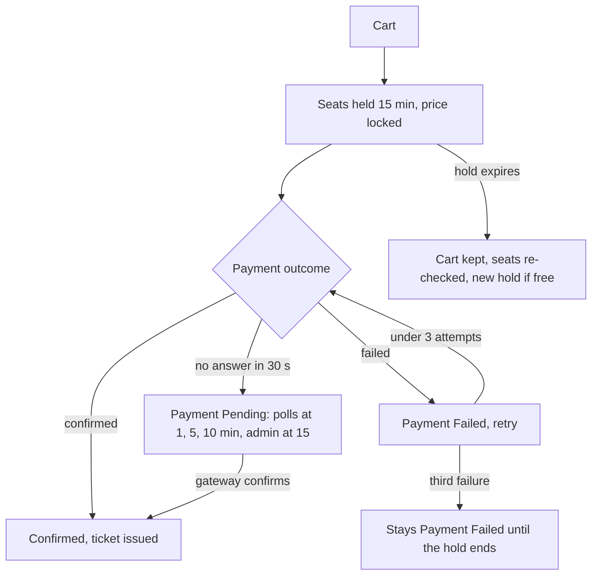

Surfaces: responsive web (trips-enjoy.com) and mobile apps. Roles: visitor, traveler. Parent features are in [Parent Tracker](/en/docs/user-flows/parent).

## Registration

| Field | Required | Notes |
|---|---|---|
| Full name | Yes | |
| Email | One of email or phone | Must verify the one given (D-20) |
| Phone | One of email or phone | E.164; must verify if given |
| Password | Yes, unless the traveler chooses code-only sign-in | 12+ characters, breached-password check |
| Country | Yes | Sets the account's market ([BRL-23](/en/docs/brd/requirements#7-business-rules), [BRL-27](/en/docs/brd/requirements#7-business-rules)) |
| Language | Yes | Arabic or English; defaults from the device |
| Terms and privacy consent | Yes | Recorded with text version |
| Marketing consent | No | Separate from transactional messages |

## Approval

None. The account is active on verification, on the Free plan.

## Flows

### UF-TRV-01. Browse as a visitor
Actor: visitor. Trigger: opens the site or app.
<Steps>
<Step>
Home shows featured and upcoming public trips from live markets only — the allowed countries ([FR-MKT-06](/en/docs/srs/requirements/mkt#fr-mkt-06--country-scope-and-listing-filter)) — with search by destination, date, organization, price and category, and a country filter limited to allowed countries.
</Step>
<Step>
Visitor opens a trip: description, organization, dates, route and stops, vehicles, programs with prices, base price in the trip's currency, seat mode, policy summary.
</Step>
<Step>
Book Now asks the visitor to sign up or sign in, then returns to the same trip.
</Step>
</Steps>
Rules: [FR-TRIP-02](/en/docs/srs/requirements/trip#fr-trip-02--draft-public-and-targeted-publishing) (drafts and targeted trips hidden), [FR-TRV-02](/en/docs/srs/requirements/trv#fr-trv-02--trip-visibility-and-early-access) (VIP early access hidden), [FR-MKT-03](/en/docs/srs/requirements/mkt#fr-mkt-03--cross-market-browsing), [FR-MKT-06](/en/docs/srs/requirements/mkt#fr-mkt-06--country-scope-and-listing-filter) (listings and the country filter offer allowed countries only).

### UF-TRV-02. Register and verify
Actor: visitor. Trigger: Sign up as traveler.
<Steps>
<Step>
Fills the registration form above.
</Step>
<Step>
Receives a code by SMS, WhatsApp or email; enters it.
</Step>
<Step>
Lands on a short onboarding: profile photo (optional), notification preferences, plan choice (Free selected; Explorer and VIP offered).
</Step>
<Step>
Returns to the trip they were viewing, or to home.
</Step>
</Steps>
Edge cases: code expired (resend after countdown); 5 wrong codes (paused 15 minutes); 3 failed deliveries (offer the other channel); email or phone already registered (offer sign-in and password reset).
Rules: [FR-AUTH-01](/en/docs/srs/requirements/auth#fr-auth-01--role-specific-registration-paths) to [FR-AUTH-03](/en/docs/srs/requirements/auth#fr-auth-03--verification-by-one-time-code).

### UF-TRV-03. Book a trip
Actor: traveler. Trigger: Book Now on a published trip.
<Steps>
<Step>
**Travelers**: number of passengers; name per passenger; child flag where a passenger is a minor.
</Step>
<Step>
**Programs**: pre-required programs are added and locked; optional ones can be added by toggle, quantity, or tier; VIP-only programs are locked for Free and Explorer with an upgrade prompt; full programs show unavailable. The summary updates live with the plan discount on programs (5 or 10 percent).
</Step>
<Step>
**Seats**: if self-selection is on, a live seat map of the assigned vehicle; picking a seat holds it for 15 minutes with a visible countdown. During the priority window, Free travelers see the map read-only. If company-assigned, the step shows "seat assigned later".
</Step>
<Step>
**Summary**: base, programs, discounts, coupon field, optional tax number for a B2B invoice, total with currency code. The price is locked from the start of the hold.
</Step>
<Step>
**Payment**: methods of the trip's market; the gateway page or SDK opens; no card fields on the platform.
</Step>
<Step>
**Result**: Confirmed (ticket with booking reference and boarding code, receipt, invoice), Pending (confirming payment), or Failed (retry).
</Step>
</Steps>
Edge cases: hold expires during payment (cart kept, seats re-checked, new hold if free); third failed attempt (stays Payment Failed until the hold ends); trip sells out while in cart (seat step shows unavailable, other vehicles offered).
Rules: [FR-BKG-01](/en/docs/srs/requirements/bkg#fr-bkg-01--booking-composition) to [FR-BKG-05](/en/docs/srs/requirements/bkg#fr-bkg-05--receipts-and-invoices), [FR-SEAT-02](/en/docs/srs/requirements/seat#fr-seat-02--live-seat-map) to [FR-SEAT-04](/en/docs/srs/requirements/seat#fr-seat-04--seat-hold), [FR-PAY-07](/en/docs/srs/requirements/pay#fr-pay-07--payment-methods-per-market) to [FR-PAY-08](/en/docs/srs/requirements/pay#fr-pay-08--payment-pending), [FR-PRG-02](/en/docs/srs/requirements/prg#fr-prg-02--program-types), [FR-PRG-03](/en/docs/srs/requirements/prg#fr-prg-03--live-booking-summary).

The engine view of this pipeline, including callback idempotency and escalation, is the [booking and payment workflow](/en/docs/workflows/booking-payment).

### UF-TRV-04. Apply a coupon
<Steps>
<Step>
Enters a code at Summary.
</Step>
<Step>
Valid: discount line appears and the total updates. Invalid: the first failing reason (not found, paused, expired, not applicable to this booking, exhausted, already used, minimum spend not met).
</Step>
<Step>
A second non-stackable coupon is refused; the first stays.
</Step>
</Steps>
Rules: [FR-CPN-02](/en/docs/srs/requirements/cpn#fr-cpn-02--cross-entity-rejection), [FR-CPN-03](/en/docs/srs/requirements/cpn#fr-cpn-03--real-time-validation).

### UF-TRV-05. Manage bookings
<Steps>
<Step>
My Bookings lists upcoming, past and cancelled bookings with state.
</Step>
<Step>
Booking detail: trip, passengers, seats, programs, totals, payment status, policy, ticket, receipt, invoice, and actions allowed by state.
</Step>
<Step>
Receipts and invoices list; export on VIP.
</Step>
</Steps>
Rules: [FR-BKG-05](/en/docs/srs/requirements/bkg#fr-bkg-05--receipts-and-invoices), [FR-TRV-03](/en/docs/srs/requirements/trv#fr-trv-03--history-and-receipts-by-plan).

### UF-TRV-06. Cancel a booking
<Steps>
<Step>
From booking detail, Cancel shows the refund preview from the policy (placeholder: 80 percent at 48 hours or more, 50 percent from 24 to under 48, none under 24) and the coupon effect.
</Step>
<Step>
Confirms. The booking moves to Cancelled, then Refund Pending until the gateway confirms ("refund in progress"), then Refunded.
</Step>
<Step>
After the cut-off, the traveler can send a request to the organization instead (decided within 2 working days, then admin).
</Step>
</Steps>
Edge cases: after departure or check-in, cancel is replaced by Open a dispute.
Rules: [FR-BKG-04](/en/docs/srs/requirements/bkg#fr-bkg-04--traveler-cancellation-and-refund), [FR-PAY-03](/en/docs/srs/requirements/pay#fr-pay-03--refund-execution), [BRL-11](/en/docs/brd/requirements#7-business-rules), [BRL-12](/en/docs/brd/requirements#7-business-rules).

### UF-TRV-07. Choose a remedy after a trip change
Trigger: the organization changes a program, seat mode, vehicle or time that affects the booking.
<Steps>
<Step>
Notification and banner on the booking with the change.
</Step>
<Step>
Options: accept the change, switch option (another program or vehicle where offered), or cancel with a full refund.
</Step>
<Step>
Choice within 7 days; otherwise the case goes to admin.
</Step>
</Steps>
Rules: [FR-TRIP-06](/en/docs/srs/requirements/trip#fr-trip-06--changes-that-affect-confirmed-bookings), [BRL-24](/en/docs/brd/requirements#7-business-rules).

### UF-TRV-08. Trip day
<Steps>
<Step>
Ticket with boarding code, vehicle label, seat (when assigned), pickup point and time, moderator contact, check-in status.
</Step>
<Step>
After check-in: status "on board"; programs and schedule.
</Step>
<Step>
No live vehicle position or ETA is shown to travelers.
</Step>
</Steps>
Rules: [FR-TRK-07](/en/docs/srs/requirements/trk#fr-trk-07--no-live-position-for-travelers), [BRL-29](/en/docs/brd/requirements#7-business-rules).

### UF-TRV-09. Albums
<Steps>
<Step>
Trip history lists completed trips; each shows albums the traveler may see.
</Step>
<Step>
Public albums: view; download the watermarked or medium copy. Shared-link and selected-user albums: view only.
</Step>
<Step>
A shared link opened while signed out asks the traveler to sign in.
</Step>
</Steps>
Rules: [FR-MED-05](/en/docs/srs/requirements/med#fr-med-05--selected-user-access), [FR-MED-07](/en/docs/srs/requirements/med#fr-med-07--traveler-access-and-download).

### UF-TRV-10. Change plan
<Steps>
<Step>
Plans page compares Free, Explorer and VIP with prices in the account's market currency.
</Step>
<Step>
Upgrade opens the gateway page in the browser; benefits apply at once with proration.
</Step>
<Step>
Downgrade is scheduled for the cycle end and can be cancelled.
</Step>
</Steps>
Rules: [FR-TRV-05](/en/docs/srs/requirements/trv#fr-trv-05--plan-changes), [FR-SUB-04](/en/docs/srs/requirements/sub#fr-sub-04--upgrade-downgrade-and-cancellation).

### UF-TRV-11. Apply for a supplier role
<Steps>
<Step>
Account menu shows Become a driver, Become a photographer, Register an organization.
</Step>
<Step>
Driver: handoff to the driver app. Photographer: handoff to the studio. Organization: handoff to the web form (web only).
</Step>
<Step>
While pending or after rejection, traveler access is unchanged.
</Step>
</Steps>
Rules: [FR-TRV-06](/en/docs/srs/requirements/trv#fr-trv-06--supplier-application-keeps-traveler-access), [FR-AUTH-06](/en/docs/srs/requirements/auth#fr-auth-06--multi-role-accounts).

### UF-TRV-12. Profile, language and notifications
Edit name, photo, contacts (re-verify on change), language, and per-category channels. Security messages cannot be turned off.
Rules: [FR-TRV-01](/en/docs/srs/requirements/trv#fr-trv-01--profile-and-preferences), [FR-NTF-01](/en/docs/srs/requirements/ntf#fr-ntf-01--channels-by-preference).

### UF-TRV-13. Privacy requests
<Steps>
<Step>
Request a data copy: verified by code, delivered within 30 days as a download link.
</Step>
<Step>
Request deletion: see [UF-SHR-09](/en/docs/user-flows/shared#uf-shr-09-account-deletion).
</Step>
</Steps>
Rules: [FR-TRV-07](/en/docs/srs/requirements/trv#fr-trv-07--data-copy-and-deletion), [FR-AUTH-09](/en/docs/srs/requirements/auth#fr-auth-09--account-deletion-with-a-30-day-grace-period).

### UF-TRV-14. Open a dispute
<Steps>
<Step>
From a booking: choose type (booking, payment, refund, organization conduct, other), describe, attach up to 5 files.
</Step>
<Step>
Track status: Open, Information Requested, Under Review, Resolved, Closed.
</Step>
</Steps>
Rules: [FR-ADM-08](/en/docs/srs/requirements/adm#fr-adm-08--dispute-handling).

### UF-TRV-15. Payment outcome and pending resolution
Actor: traveler. Trigger: payment submitted, result not immediate.
<Steps>
<Step>
The gateway page or SDK opens; no card fields ever appear on the platform.
</Step>
<Step>
While the gateway is silent, the booking shows Confirming payment: the system polls at 1, 5 and 10 minutes and the seats stay held.
</Step>
<Step>
Confirmed: the ticket, receipt and invoice appear at once. Failed: retry is offered while attempts remain under three for this hold.
</Step>
<Step>
After the third failure the booking stays Payment Failed until the hold ends; a support contact is offered when the case escalates to admin at 15 minutes.
</Step>
</Steps>
Edge cases: hold expires during payment (cart kept, seats re-checked, new hold only if free).
Rules: [FR-PAY-01](/en/docs/srs/requirements/pay#fr-pay-01--payment-outcomes), [FR-PAY-02](/en/docs/srs/requirements/pay#fr-pay-02--idempotent-callbacks), [FR-PAY-08](/en/docs/srs/requirements/pay#fr-pay-08--payment-pending), [FR-BKG-03](/en/docs/srs/requirements/bkg#fr-bkg-03--retry-without-losing-the-cart).

### UF-TRV-16. Life after a downgrade
Actor: traveler. Trigger: the billing cycle ends on a downgraded plan.
<Steps>
<Step>
Everything already booked keeps working: over-limit items created before the downgrade continue to be available.
</Step>
<Step>
The next action beyond the new limit is refused by the server-side gate, which names the category, the current plan, the limit and the next tier.
</Step>
<Step>
The upgrade prompt offers the next tier; counters reset on the 1st of the month at 00:00 in the owner's time zone.
</Step>
</Steps>
Edge cases: grace-period rules apply before the downgrade takes effect; see the subscriptions workflow.
Rules: [FR-SUB-09](/en/docs/srs/requirements/sub#fr-sub-09--limits-after-a-downgrade), [FR-SUB-10](/en/docs/srs/requirements/sub#fr-sub-10--counter-reset), [FR-SUB-02](/en/docs/srs/requirements/sub#fr-sub-02--feature-gates).

## Booking states seen by the traveler

| State | Label shown |
|---|---|
| Seats Held | Seats held, time left mm:ss |
| Payment Pending | Confirming payment |
| Payment Failed | Payment did not go through, retry |
| Confirmed | Confirmed |
| Checked In / Checked Out | On board / Off vehicle |
| Cancelled | Cancelled |
| Refund Pending | Refund in progress |
| Refunded | Refunded |
