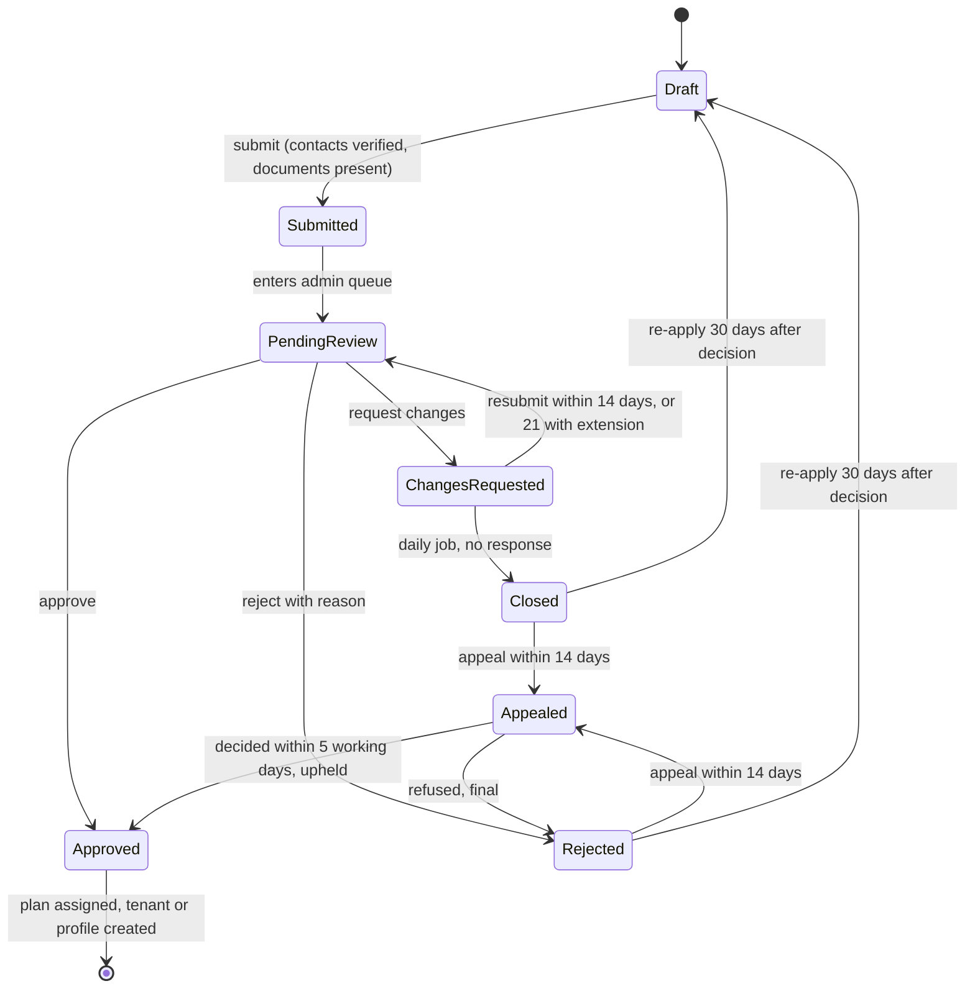

Every organization, platform driver and platform photographer goes through one application workflow before they can act on the platform ([BRL-02](/en/docs/brd/requirements#7-business-rules)). This page is the engine view of state machine 7.5; the human side is [UF-ADM-02](/en/docs/user-flows/admin#uf-adm-02-review-an-application).

**Delivery phase:** P1 Foundation (organizations), P4 Marketplace supply (drivers and photographers).

## Trigger and actors

- **Trigger:** an applicant submits a Draft application (contacts verified, documents present).
- **Actors:** the applicant; the admin reviewer; the daily closure job; the system (plan assignment, tenant creation, notifications).

## Diagram

## Timers and rules

| Step | Timer (verbatim) | Rule trace |
|---|---|---|
| Review queue flag | "more than 2 working days" pending flags the application; median decision target is 2 working days | [FR-ONB-03](/en/docs/srs/requirements/onb#fr-onb-03--decision-time-target), [BR-ONB-03](/en/docs/brd/requirements#62-applications-and-approvals-onb) |
| Changes-requested window | "14 days to respond, with a reminder on day 7 and one 7-day extension on request" | [FR-ONB-04](/en/docs/srs/requirements/onb#fr-onb-04--changes-requested), [BR-ONB-04](/en/docs/brd/requirements#62-applications-and-approvals-onb), D-235 |
| Closure job | The daily job closes unanswered changes; the closure day when the extension is used is [OPEN: [OD-32](/en/docs/brd/compliance#11-open-decisions)] | [FR-ONB-04](/en/docs/srs/requirements/onb#fr-onb-04--changes-requested), [OD-32](/en/docs/brd/compliance#11-open-decisions) |
| Appeal window | "within 14 days of the notice", one appeal per rejection, decided "within 5 working days" | [FR-ONB-05](/en/docs/srs/requirements/onb#fr-onb-05--rejection-appeal-and-re-application), [BR-ONB-05](/en/docs/brd/requirements#62-applications-and-approvals-onb), [BRL-06](/en/docs/brd/requirements#7-business-rules), D-237 |
| Re-apply cooldown | "30 days after rejection; a closed application counts as rejected" | [FR-ONB-05](/en/docs/srs/requirements/onb#fr-onb-05--rejection-appeal-and-re-application), [BRL-06](/en/docs/brd/requirements#7-business-rules) |
| On approval | Plan assigned and tenant or profile created automatically; supplier actions stay refused until then | [FR-ONB-01](/en/docs/srs/requirements/onb#fr-onb-01--application-and-supplier-access), [FR-ORG-02](/en/docs/srs/requirements/org#fr-org-02--tenant-setup-on-approval), D-24, D-77 |
| Notifications | Every state change notifies the applicant in their language on at least one enabled channel | [FR-ONB-09](/en/docs/srs/requirements/onb#fr-onb-09--applicant-status-notifications) |
| Freshness gates at submission | Driver lab results "dated within the last 30 days"; insurance "valid for at least 3 more months" | [FR-ONB-07](/en/docs/srs/requirements/onb#fr-onb-07--driver-vehicle-and-insurance-details), [FR-ONB-08](/en/docs/srs/requirements/onb#fr-onb-08--lab-consent-and-initial-result) |

## Stories

- **As an applicant**, I want my pending review flagged when it slips past two working days, so that the platform's own SLA works in my favor. *([FR-ONB-03](/en/docs/srs/requirements/onb#fr-onb-03--decision-time-target))*
- **As an admin reviewer**, I want unanswered change requests to close themselves after the window, so that the queue only holds live cases. *([FR-ONB-04](/en/docs/srs/requirements/onb#fr-onb-04--changes-requested))*
- **As a rejected applicant**, I want one appeal decided within five working days, so that a mistake does not cost me a month. *([FR-ONB-05](/en/docs/srs/requirements/onb#fr-onb-05--rejection-appeal-and-re-application), [BRL-06](/en/docs/brd/requirements#7-business-rules))*
- **As an approved organization**, I want my plan and tenant created the moment I am approved, so that I can start work without a second wait. *([FR-ORG-02](/en/docs/srs/requirements/org#fr-org-02--tenant-setup-on-approval))*
