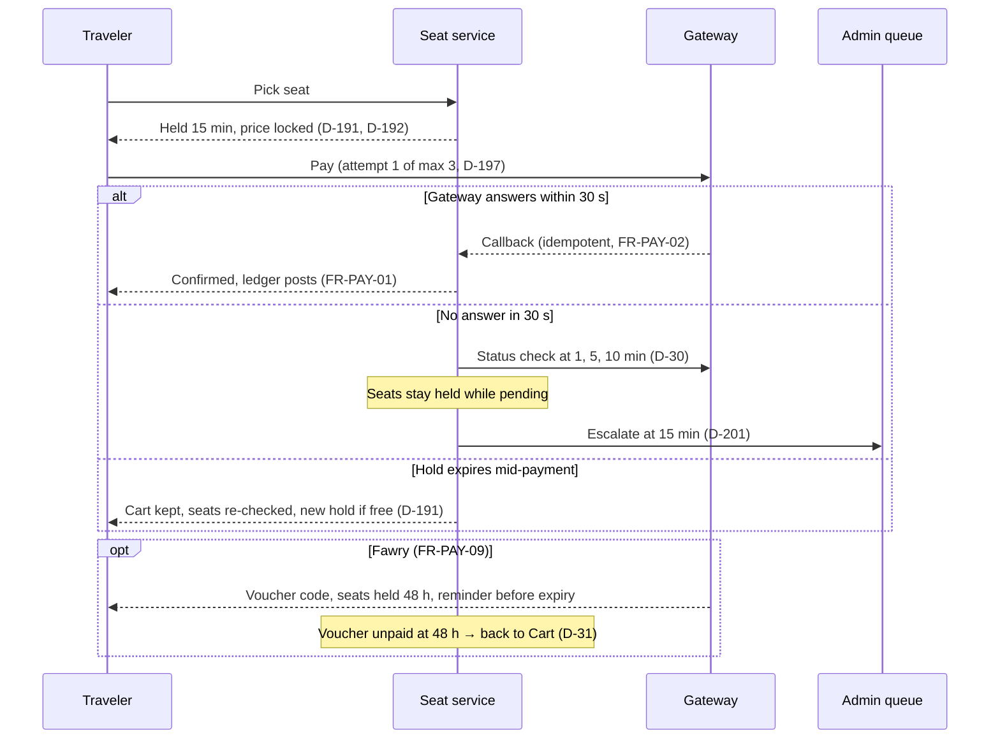

The booking pipeline is the platform's most timer-dense workflow: a 15-minute seat hold with a price lock, a three-attempt payment cap, a 48-hour Fawry voucher lane, and a gateway poll schedule that escalates to admin. This is the engine view of state machines 7.2 (Booking) and 7.3 (Seat); the traveler side is [UF-TRV-03](/en/docs/user-flows/traveler#uf-trv-03-book-a-trip).

**Delivery phase:** P2 Single-vehicle pilot (Egypt).

## Trigger and actors

- **Trigger:** a traveler picks a seat (self-selection) or confirms passengers (company-assigned).
- **Actors:** the traveler; the gateway; the payment callback relay; the admin escalation queue.

## Diagram

## Timers and rules

| Step | Timer (verbatim) | Rule trace |
|---|---|---|
| Seat hold | "held for 15 minutes and released automatically when it expires"; price "locked when the hold starts" | [BRL-08](/en/docs/brd/requirements#7-business-rules), [FR-SEAT-04](/en/docs/srs/requirements/seat#fr-seat-04--seat-hold), D-191, D-192 |
| Hold expiry during payment | "A retry after the hold expires keeps the cart, re-checks the seats and starts a new 15-minute hold only if they are still free" | [FR-BKG-03](/en/docs/srs/requirements/bkg#fr-bkg-03--retry-without-losing-the-cart), D-191 |
| Attempt cap | "up to 3 attempts per hold"; after the third the booking stays Payment Failed until the hold expires | [FR-BKG-03](/en/docs/srs/requirements/bkg#fr-bkg-03--retry-without-losing-the-cart), [BR-BKG-03](/en/docs/brd/requirements#67-booking-and-payment-bkg), D-197 |
| Gateway timeout | "If the gateway does not answer within 30 seconds… checks status at 1, 5 and 10 minutes and escalates to admin at 15 minutes. Seats stay held while pending" | [FR-PAY-08](/en/docs/srs/requirements/pay#fr-pay-08--payment-pending), D-30, D-201 |
| Callbacks | "at most once per gateway event identifier"; callbacks queued and replayed | [FR-PAY-02](/en/docs/srs/requirements/pay#fr-pay-02--idempotent-callbacks), [NFR-AVL-03](/en/docs/srs/quality#83-availability-nfr-avl) |
| Fawry voucher | "issue a voucher valid 48 hours and hold the seats for that window. An unpaid voucher expires and releases the seats" | [FR-PAY-09](/en/docs/srs/requirements/pay#fr-pay-09--fawry-cash-vouchers), [BRL-08](/en/docs/brd/requirements#7-business-rules), D-31, D-41 |
| Success | Confirmed posts the ledger entry; ticket issued with booking reference and boarding code | [FR-PAY-01](/en/docs/srs/requirements/pay#fr-pay-01--payment-outcomes), [UF-TRV-03](/en/docs/user-flows/traveler#uf-trv-03-book-a-trip) |
| Seat states | Available, Held, Reserved, Checked In, Checked Out, Released — the loop behind the hold | [FR-SEAT-05](/en/docs/srs/requirements/seat#fr-seat-05--seat-states) |
| Seat selection | Company-assigned by default; self-selection by plan and trip setting | [FR-SEAT-01](/en/docs/srs/requirements/seat#fr-seat-01--company-assigned-by-default), [FR-SEAT-07](/en/docs/srs/requirements/seat#fr-seat-07--self-selection-by-plan) |
| Booking states | The ten traveler-visible states of machine 7.2, from Cart to Refunded | [FR-BKG-07](/en/docs/srs/requirements/bkg#fr-bkg-07--booking-states) |
| Program discounts | Plans discount program prices by 5 or 10 percent in the live summary | [FR-TRV-04](/en/docs/srs/requirements/trv#fr-trv-04--program-discounts) |
| Concurrency | Hold races resolved with a Redis lock and a conditional update on seat status | ERD trip_seats |

## Stories

- **As a traveler**, I want the price locked the moment my seat is held, so that nothing changes under me while I pay. *([FR-SEAT-04](/en/docs/srs/requirements/seat#fr-seat-04--seat-hold), D-192)*
- **As a traveler**, I want a pending payment resolved by polling instead of a dead end, so that a slow gateway does not cost me the seat. *([FR-PAY-08](/en/docs/srs/requirements/pay#fr-pay-08--payment-pending))*
- **As an admin**, I want gateway no-answers escalated after 15 minutes with the seats still held, so that I can finish what the timer could not. *([FR-PAY-08](/en/docs/srs/requirements/pay#fr-pay-08--payment-pending), D-201)*
- **As a Fawry user**, I want 48 hours to pay the voucher with a reminder before expiry, so that cash payment works like any other method. *([FR-PAY-09](/en/docs/srs/requirements/pay#fr-pay-09--fawry-cash-vouchers), D-31)*
