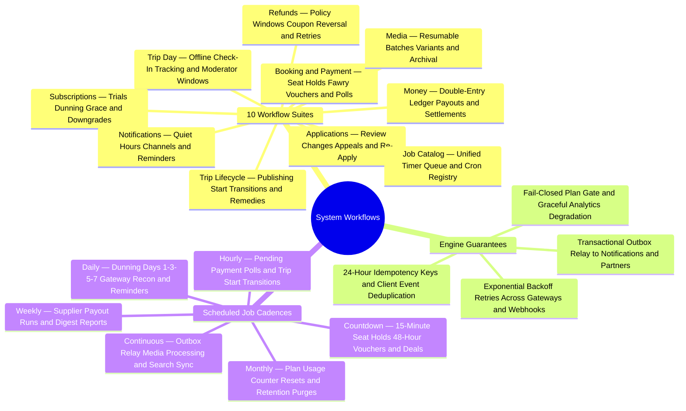

The user flows describe what people do. This section describes what the **system** does: every process with a state, a timer, a retry or a queue — the kind of process a workflow engine owns. The SRS cites a *System workflows* source document for these; these pages are that document, fully traced across all **213** functional requirements.

Every page follows the same shape: the trigger, the actors, a diagram, the timers, and the **stories** the workflow serves.

<TraceBar
  brd={[
    { label: 'Business Rules §7', href: '/en/docs/brd/requirements#7-business-rules', detail: 'BRL-01..30' },
  ]}
  srs={[
    { label: '10 State Machines §7', href: '/en/docs/srs/state-machines' },
    { label: 'Availability & Retries', href: '/en/docs/srs/quality#83-availability-nfr-avl' },
  ]}
  erd={[
    { label: 'Outbox & Idempotency', href: '/en/docs/erd/domains/platform' },
    { label: 'Data Model', href: '/en/docs/erd' },
  ]}
  plan={[
    { label: 'Delivery Plan', href: '/en/docs/plan', detail: '231 tasks' },
  ]}
  workflows={[
    { label: 'Job Catalog', href: '/en/docs/workflows/scheduled-jobs' },
    { label: 'Coverage Matrix', href: '/en/docs/workflows/coverage', detail: '213/213 FRs' },
  ]}
  userFlows={[
    { label: '106 Role Flows', href: '/en/docs/user-flows' },
  ]}
  architecture={[
    { label: 'Workers & Outbox', href: '/en/docs/architecture#service-model' },
    { label: 'Gateway Callbacks', href: '/en/docs/architecture#integrations' },
  ]}
  design={[
    { label: 'Notification Surfaces', href: '/en/docs/design#notification-surfaces' },
  ]}
  system={[
    { label: 'End-to-End Lifecycle', href: '/en/docs/system/lifecycle' },
    { label: 'Mindmap Atlas', href: '/en/docs/system/mindmaps' },
  ]}
  recommendations={[
    { label: 'Outbox & Architecture', href: '/en/docs/recommendations/architecture-and-ops#rec-arch-01', detail: 'REC-ARCH-01' },
    { label: 'Seat Holds & Offline', href: '/en/docs/recommendations/architecture-and-ops#rec-book-03', detail: 'REC-BOOK-03 · REC-OFF-06' },
  ]}
/>

## The engine contract

All workflows in this section share the same execution rules, drawn from the SRS:

| Property | Rule | Trace |
|---|---|---|
| States | Every workflow is one of the ten state machines (SRS section 7) or a named pipeline below | [SRS section 7](/en/docs/srs/state-machines) |
| Timers | Time-based transitions are guards on the state machine, with verbatim windows on each page | per machine |
| Retries | Payment callbacks at most once per gateway event identifier; notifications 3 times with exponential backoff; refunds 3 times; webhooks 5 times over 24 hours | [FR-PAY-02](/en/docs/srs/requirements/pay#fr-pay-02--idempotent-callbacks), [FR-NTF-05](/en/docs/srs/requirements/ntf#fr-ntf-05--delivery-records-and-retries), [FR-PAY-03](/en/docs/srs/requirements/pay#fr-pay-03--refund-execution), [FR-ORG-06](/en/docs/srs/requirements/org#fr-org-06--crm-and-webhooks) |
| Idempotency | Idempotency keys are valid for 24 hours; duplicate replays are ignored by client event ID | [SRS section 6.4](/en/docs/srs/data#64-retention), [FR-CHK-05](/en/docs/srs/requirements/chk#fr-chk-05--offline-queue) |
| Jobs | Named scheduled jobs run the timers: daily, hourly, weekly and monthly cadences — see the job catalog | [FR-ONB-04](/en/docs/srs/requirements/onb#fr-onb-04--changes-requested), [FR-NTF-07](/en/docs/srs/requirements/ntf#fr-ntf-07--trip-reminders-and-change-notices), [FR-ACC-03](/en/docs/srs/requirements/acc#fr-acc-03--supplier-earnings-and-payouts), [FR-SUB-10](/en/docs/srs/requirements/sub#fr-sub-10--counter-reset) |
| Failure posture | The plan service fails closed; analytics and exports degrade without blocking bookings | [FR-SUB-11](/en/docs/srs/requirements/sub#fr-sub-11--plan-service-failure), [NFR-OBS-04](/en/docs/srs/quality#86-observability-nfr-obs) |

## The workflows

<MindmapBlock
  title="System Workflows, Engine Guarantees & Scheduled Cadences"
  caption="The complete background choreography of Trips Enjoy: 10 workflow and job suites, transactional execution guarantees, and scheduled timer cadences from continuous outbox pipelines to monthly counter resets."
  trace={{
    workflows: [
      { label: 'Applications', href: '/en/docs/workflows/applications' },
      { label: 'Booking & Payment', href: '/en/docs/workflows/booking-payment' },
      { label: 'Refunds', href: '/en/docs/workflows/refunds' },
      { label: 'Trip Lifecycle', href: '/en/docs/workflows/trip-lifecycle' },
      { label: 'Trip Day', href: '/en/docs/workflows/trip-day' },
      { label: 'Money', href: '/en/docs/workflows/money' },
      { label: 'Subscriptions', href: '/en/docs/workflows/subscriptions' },
      { label: 'Notifications', href: '/en/docs/workflows/notifications' },
      { label: 'Media', href: '/en/docs/workflows/media' },
      { label: 'Job Catalog', href: '/en/docs/workflows/scheduled-jobs' },
    ],
    srs: [
      { label: 'State Machines §7', href: '/en/docs/srs/state-machines' },
    ],
    system: [
      { label: '8-Stage Lifecycle', href: '/en/docs/system/lifecycle' },
    ],
  }}
>

</MindmapBlock>

<Cards>
  <Card title="Applications" description="Review, changes, appeals and re-application with working-day SLAs." icon="ClipboardCheck" href="/en/docs/workflows/applications" />
  <Card title="Booking & Payment" description="Seat holds, attempt caps, Fawry vouchers, gateway polls and escalation." icon="CreditCard" href="/en/docs/workflows/booking-payment" />
  <Card title="Refunds" description="Policy windows, coupon reversal, gateway retries and the post-cut-off path." icon="RotateCcw" href="/en/docs/workflows/refunds" />
  <Card title="Trip Lifecycle" description="Publishing, start-time transitions, remedies and archival." icon="Map" href="/en/docs/workflows/trip-lifecycle" />
  <Card title="Trip Day" description="Check-in, offline queues, live tracking and moderator access windows." icon="ScanLine" href="/en/docs/workflows/trip-day" />
  <Card title="Money" description="Ledger, weekly payouts, invoices, reconciliation and settlement closure." icon="Landmark" href="/en/docs/workflows/money" />
  <Card title="Subscriptions" description="Trials, dunning on days 1-3-5-7, grace, downgrades and counter resets." icon="RefreshCw" href="/en/docs/workflows/subscriptions" />
  <Card title="Notifications" description="Quiet hours, retries, deduplication and the reminder job." icon="BellRing" href="/en/docs/workflows/notifications" />
  <Card title="Media" description="Upload windows, resumable batches, processing variants and archival." icon="Images" href="/en/docs/workflows/media" />
  <Card title="Job Catalog" description="Every timer, queue and scheduled job on one page." icon="CalendarClock" href="/en/docs/workflows/scheduled-jobs" />
</Cards>

## Reading the timers

Working-day SLAs (review in 2 working days, refunds sent within 2 working days) use the responsible party's market calendar. Clock timers (seat holds, quiet hours, payout runs) are absolute. Where the spec itself has not decided a value, the page says so with the open decision ID — those values follow the BRD open-decision process and link to concrete defaults in [Recommendations & Resolutions](/en/docs/recommendations/open-decisions).

## Stories in this section

Each workflow page carries user stories in the standard form — *As a (role), I want (capability), so that (value)* — each traced to the requirements it serves, so product, engineering and operations share one vocabulary.
