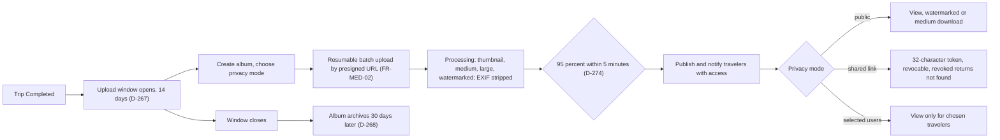

Media is the file store for the whole platform: every domain's uploads land here, and a file that is not linked to its owning entity and not created by the system is deleted automatically 24 hours after upload ([FR-MED-09](/en/docs/srs/requirements/med#fr-med-09--file-lifecycle-and-orphan-cleanup)). Albums have a clock of their own: uploading opens only after the trip completes and lasts 14 days; processing renders thumbnail, medium, large and watermarked variants with EXIF stripped; and albums archive 30 days after the window closes. The photographer surface is [UF-PHO-05](/en/docs/user-flows/photographer#uf-pho-05-create-and-upload-an-album); the traveler viewing side is [UF-TRV-09](/en/docs/user-flows/traveler#uf-trv-09-albums).

**Delivery phase:** P4 Marketplace supply.

## Trigger and actors

- **Trigger:** the trip reaches Completed.
- **Actors:** the photographer (Studio or Pro plan); the processing pipeline; the archive job; travelers with access.

## Diagram

## Timers and rules

| Step | Timer (verbatim) | Rule trace |
|---|---|---|
| Orphan purge | files unlinked for 24 hours, not system-created, deleted with their variants | [FR-MED-09](/en/docs/srs/requirements/med#fr-med-09--file-lifecycle-and-orphan-cleanup), [BRL-31](/en/docs/brd/requirements#7-business-rules) |
| Upload window | albums "only after it is Completed and within 14 days" | [FR-MED-01](/en/docs/srs/requirements/med#fr-med-01--album-creation-window), D-267 |
| Archival | "albums archive 30 days after the window closes" | [FR-MED-01](/en/docs/srs/requirements/med#fr-med-01--album-creation-window), D-268 |
| Processing SLA | "95 percent of photos finish processing within 5 minutes" | [FR-MED-02](/en/docs/srs/requirements/med#fr-med-02--resumable-batch-upload), D-274 |
| Upload | Resumable batch upload by presigned URL, client file IDs unique per batch | [FR-MED-02](/en/docs/srs/requirements/med#fr-med-02--resumable-batch-upload), ERD photos |
| Variants | thumbnail, medium, large, watermarked; EXIF stripped | [FR-MED-06](/en/docs/srs/requirements/med#fr-med-06--watermarking), [UF-PHO-05](/en/docs/user-flows/photographer#uf-pho-05-create-and-upload-an-album) |
| Watermark | "bottom right, inset 3 percent of width, 30 percent opacity", Studio and Pro only | [FR-MED-06](/en/docs/srs/requirements/med#fr-med-06--watermarking), [BR-MED-03](/en/docs/brd/requirements#611-media-and-photographers-med-pho), D-275 |
| Shared links | "32-character token and be revocable; a revoked link returns not found" — no time expiry | [FR-MED-04](/en/docs/srs/requirements/med#fr-med-04--shared-links) |
| Download logging | kept 1 year | D-271 |
| Plan limits | Album limits by plan | [FR-MED-08](/en/docs/srs/requirements/med#fr-med-08--albums-per-trip-by-plan) |

## Stories

- **As a photographer**, I want a resumable batch that survives a dropped connection, so that a wedding-sized album uploads once. *([FR-MED-02](/en/docs/srs/requirements/med#fr-med-02--resumable-batch-upload))*
- **As a traveler**, I want processed photos inside five minutes, so that the album is ready when the group chat asks. *(D-274)*
- **As a traveler in a shared-link album**, I want revoked links to vanish, so that privacy decisions are enforceable. *([FR-MED-04](/en/docs/srs/requirements/med#fr-med-04--shared-links))*
- **As an organization**, I want the window to close and the album to archive on schedule, so that media obligations have an end date. *([FR-MED-01](/en/docs/srs/requirements/med#fr-med-01--album-creation-window), D-268)*
