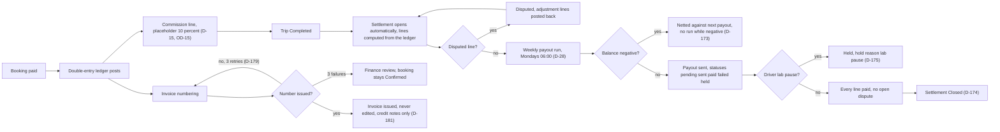

Money moves on rails: every booking posts to a double-entry ledger, payouts run Mondays at 06:00, invoice numbering retries three times before finance review, and a daily reconciliation at 08:00 Cairo time catches whatever the gateway disagrees about. This is the engine view of state machine 7.9 (Settlement); the finance role surface is [UF-ADM-13](/en/docs/user-flows/admin#uf-adm-13-finance-views).

**Delivery phase:** P2 (daily ledger reconciliation), P4 (weekly payouts), P5 (full accounting and invoices).

## Trigger and actors

- **Trigger:** a paid booking, a completed trip, a refund, or the weekly clock.
- **Actors:** the ledger; the payout run; the invoice service; the reconciliation job; finance.

## Diagram

## Timers and rules

| Step | Timer (verbatim) | Rule trace |
|---|---|---|
| Ledger | Double-entry ledger with event types booking_paid, refund, coupon, deal_cost, commission, gateway_fee, plan_charge, payout, invoice, settlement, reversal | [FR-ACC-01](/en/docs/srs/requirements/acc#fr-acc-01--double-entry-ledger) |
| Commission | placeholder "10 percent of the base trip price, configurable per market and per deal type" | D-15, [OD-15](/en/docs/brd/compliance#11-open-decisions), [FR-NEG-05](/en/docs/srs/requirements/neg#fr-neg-05--finalization) |
| Payout cadence | "weekly payout runs on Mondays at 06:00" through Stripe Connect Express, bank transfer or a local provider | [FR-ACC-03](/en/docs/srs/requirements/acc#fr-acc-03--supplier-earnings-and-payouts), BRD 5.2, D-28 |
| Negative balance | "netted against the next payout in the same currency, and no payout runs while it is negative" | [FR-ACC-03](/en/docs/srs/requirements/acc#fr-acc-03--supplier-earnings-and-payouts), D-173 |
| Holds | Payouts held during a lab-test pause | D-175 |
| Invoice numbering | "numbering retries 3 times, then the case goes to finance review"; issued invoices are never edited, credit notes reference them | [FR-ORG-07](/en/docs/srs/requirements/org#fr-org-07--b2b-and-b2c-invoices), D-179 to D-181 |
| Invoice type | B2B when a tax number is present, else B2C | [FR-ORG-07](/en/docs/srs/requirements/org#fr-org-07--b2b-and-b2c-invoices), [BRL-28](/en/docs/brd/requirements#7-business-rules), D-180 |
| Reconciliation | Gateway settlement reports compared with the ledger daily; exceptions listed | [FR-PAY-05](/en/docs/srs/requirements/pay#fr-pay-05--gateway-reconciliation), D-29 |
| Finance digest | "A finance exceptions digest goes out daily at 08:00 Cairo time"; dashboards warn when data is more than 26 hours old | [FR-ACC-09](/en/docs/srs/requirements/acc#fr-acc-09--daily-reconciliation-and-finance-digest), D-176, D-250 |
| Settlement closure | Closed when "Every line paid" and "No open dispute" | [FR-ACC-05](/en/docs/srs/requirements/acc#fr-acc-05--settlements), [BR-ACC-06](/en/docs/brd/requirements#614-accounting-invoices-and-settlements-acc), D-174 |
| Currencies | The market comes from the country; switches follow the market; rounding and display per market | [FR-MKT-02](/en/docs/srs/requirements/mkt#fr-mkt-02--market-from-country), [FR-MKT-04](/en/docs/srs/requirements/mkt#fr-mkt-04--market-switch), [FR-MKT-05](/en/docs/srs/requirements/mkt#fr-mkt-05--rounding-and-display) |
| Tenant isolation | Every ledger line is tenant-scoped with the owning organization | [FR-ORG-01](/en/docs/srs/requirements/org#fr-org-01--tenant-isolation) |
| Invoices across parties | Invoices for every party pair — traveler, organization, supplier, platform | [FR-ACC-08](/en/docs/srs/requirements/acc#fr-acc-08--invoices-across-all-parties) |
| Revenue reporting | Plan revenue reported for finance | [FR-SUB-06](/en/docs/srs/requirements/sub#fr-sub-06--revenue-reporting) |
| Exports | "expire after 7 days", "ready within 15 minutes" | [FR-ACC-06](/en/docs/srs/requirements/acc#fr-acc-06--exports-by-plan), D-249, D-177 |

## Stories

- **As a finance operator**, I want payouts to run themselves every Monday with negative balances netted, so that my week starts with exceptions, not with manual runs. *([FR-ACC-03](/en/docs/srs/requirements/acc#fr-acc-03--supplier-earnings-and-payouts), D-28)*
- **As an organization owner**, I want a daily digest of money exceptions at a known hour, so that problems surface before callers do. *([FR-ACC-09](/en/docs/srs/requirements/acc#fr-acc-09--daily-reconciliation-and-finance-digest), D-176)*
- **As an auditor**, I want issued invoices immutable with credit notes as the only correction, so that the trail never rewrites history. *(D-181)*
- **As a driver**, I want my payout held — not lost — during a lab pause, so that resolving paperwork restores the money. *(D-175)*
