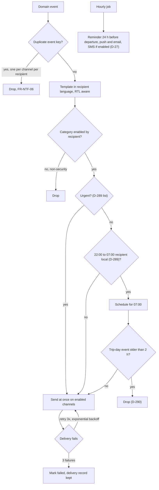

Notifications are a queue with manners: nothing loud between 22:00 and 07:00 recipient-local, deferred messages released at 07:00, trip-day events older than two hours dropped, one message per event per channel per recipient, and three retries with exponential backoff when a channel fails. The recipient side is [UF-SHR-15](/en/docs/user-flows/shared#uf-shr-15-notification-delivery-and-quiet-hours).

**Delivery phase:** P1 (channels and templates), P3 (quiet hours).

## Trigger and actors

- **Trigger:** any domain event that maps to a notification template.
- **Actors:** the notification service; the quiet-hours scheduler; the retry queue; the hourly reminder job.

## Diagram

## Timers and rules

| Step | Timer (verbatim) | Rule trace |
|---|---|---|
| Quiet hours | "SMS and push shall not be sent between 22:00 and 07:00 recipient local time unless urgent"; deferred messages go at 07:00; trip-day events older than 2 hours are dropped | [FR-NTF-03](/en/docs/srs/requirements/ntf#fr-ntf-03--quiet-hours), [BR-NTF-03](/en/docs/brd/requirements#612-notifications-ntf), D-289, D-290 |
| Retries | "Failures retry 3 times with exponential backoff" | [FR-NTF-05](/en/docs/srs/requirements/ntf#fr-ntf-05--delivery-records-and-retries) |
| Dedup | "One event shall produce at most one message per channel per recipient" (unique event key) | [FR-NTF-06](/en/docs/srs/requirements/ntf#fr-ntf-06--no-duplicate-delivery) |
| Reminders | "a reminder 24 hours before departure by push and email, plus SMS if enabled… when the hourly job runs" | [FR-NTF-07](/en/docs/srs/requirements/ntf#fr-ntf-07--trip-reminders-and-change-notices), D-27 |
| Change notices | "Vehicle, driver or time changes are notified within 1 hour" | [FR-NTF-07](/en/docs/srs/requirements/ntf#fr-ntf-07--trip-reminders-and-change-notices), D-186 |
| Language | Templates versioned, language and layout per recipient with RTL | [FR-NTF-02](/en/docs/srs/requirements/ntf#fr-ntf-02--language-and-layout), [FR-NTF-04](/en/docs/srs/requirements/ntf#fr-ntf-04--versioned-templates) |
| Security messages | Account security messages cannot be disabled | [FR-NTF-01](/en/docs/srs/requirements/ntf#fr-ntf-01--channels-by-preference) |
| Delivery records | Delivery states queued, sent, delivered, failed, dropped with attempt and next-attempt timestamps | [FR-NTF-05](/en/docs/srs/requirements/ntf#fr-ntf-05--delivery-records-and-retries), ERD notifications |

## Stories

- **As a recipient**, I want silence between 22:00 and 07:00 unless it is urgent, so that the platform respects my night. *([FR-NTF-03](/en/docs/srs/requirements/ntf#fr-ntf-03--quiet-hours), D-289)*
- **As an operations controller**, I want trip-day staleness to drop old notifications, so that a catch-up burst never confuses the morning. *(D-290)*
- **As a traveler**, I want one reminder per channel, not five, so that the trip day is calm. *([FR-NTF-06](/en/docs/srs/requirements/ntf#fr-ntf-06--no-duplicate-delivery))*
- **As an admin**, I want versioned templates, so that a wording fix does not fork history. *([FR-NTF-04](/en/docs/srs/requirements/ntf#fr-ntf-04--versioned-templates))*
