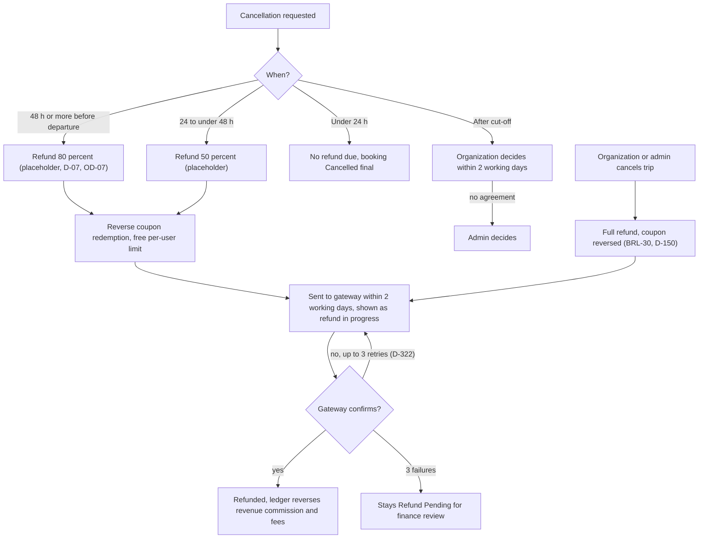

Refunds are a pipeline, not a button: the policy engine computes the amount from the cancellation window, the coupon redemption is reversed, the gateway gets up to three attempts, and anything the gateway refuses lands in finance review. The traveler side is [UF-TRV-06](/en/docs/user-flows/traveler#uf-trv-06-cancel-a-booking); admin out-of-policy refunds are [UF-ADM-16](/en/docs/user-flows/admin#uf-adm-16-out-of-policy-refund).

**Delivery phase:** P2 (policy refund), P5 (coupon reversal and full accounting).

## Trigger and actors

- **Trigger:** a cancellation (traveler, organization or admin), a trip change remedy, or an out-of-policy decision.
- **Actors:** the policy engine; the refund job; the gateway; finance review.

## Diagram

## Timers and rules

| Step | Timer (verbatim) | Rule trace |
|---|---|---|
| Policy windows | "80 percent at 48 hours or more, 50 percent from 24 to under 48 hours, none under 24 hours" (placeholder) | [BRL-12](/en/docs/brd/requirements#7-business-rules), [FR-BKG-04](/en/docs/srs/requirements/bkg#fr-bkg-04--traveler-cancellation-and-refund), D-07, [OD-07](/en/docs/brd/compliance#11-open-decisions) |
| Fees | "All fees are refundable until non-refundable fees are set" | [BRL-12](/en/docs/brd/requirements#7-business-rules), D-156 |
| Coupon reversal | "A refund reverses the coupon redemption and frees the traveler's per-user limit"; an Exhausted coupon returns to Active if still in its window | [BRL-11](/en/docs/brd/requirements#7-business-rules), [FR-CPN-06](/en/docs/srs/requirements/cpn#fr-cpn-06--redemption-and-reversal) |
| Send SLA | "sent to the gateway within 2 working days and shown as 'refund in progress'" | [FR-PAY-03](/en/docs/srs/requirements/pay#fr-pay-03--refund-execution) |
| Confirmation | "It is Refunded only after the gateway confirms; the ledger reverses revenue, commission and fees then" | [FR-PAY-03](/en/docs/srs/requirements/pay#fr-pay-03--refund-execution) |
| Retries | "Failed refunds retry 3 times, then stay Refund Pending for finance review" | [FR-PAY-03](/en/docs/srs/requirements/pay#fr-pay-03--refund-execution), D-149, D-35, D-322 |
| Post cut-off | "Requests after the cut-off go to the organization, which decides within 2 working days, then to admin" | [FR-BKG-04](/en/docs/srs/requirements/bkg#fr-bkg-04--traveler-cancellation-and-refund), [BR-BKG-04](/en/docs/brd/requirements#67-booking-and-payment-bkg), D-151 |
| Hard stops | "No cancellation after departure or after check-in" — disputes take over | D-152, D-153 |
| Trip cancelled by org or admin | "every confirmed booking is refunded in full, with coupon redemptions reversed" | [BRL-30](/en/docs/brd/requirements#7-business-rules), [FR-BKG-06](/en/docs/srs/requirements/bkg#fr-bkg-06--organization-cancellation-of-a-trip), D-150 |
| Out-of-policy | Admin refund with reason and audit log | [FR-PAY-04](/en/docs/srs/requirements/pay#fr-pay-04--refunds-outside-policy), [BRL-19](/en/docs/brd/requirements#7-business-rules) |
| Remedy cancel | Trip-change remedy "cancel with full refund"; refund reason includes remedy | [BRL-24](/en/docs/brd/requirements#7-business-rules), [FR-TRIP-06](/en/docs/srs/requirements/trip#fr-trip-06--changes-that-affect-confirmed-bookings) |

## Stories

- **As a traveler**, I want the refund preview to show the exact policy amount before I confirm, so that I decide with real numbers. *([FR-BKG-04](/en/docs/srs/requirements/bkg#fr-bkg-04--traveler-cancellation-and-refund))*
- **As a finance operator**, I want gateway-refused refunds to stop in review after three retries instead of looping, so that the queue stays honest. *([FR-PAY-03](/en/docs/srs/requirements/pay#fr-pay-03--refund-execution), D-322)*
- **As an organization**, I want a clean full-refund path when I cancel a trip, so that making travelers whole is one action, not a spreadsheet. *([BRL-30](/en/docs/brd/requirements#7-business-rules))*
- **As a coupon owner**, I want a refunded booking to free my per-user coupon limit, so that a cancelled trip does not burn my discount. *([BRL-11](/en/docs/brd/requirements#7-business-rules), [FR-CPN-06](/en/docs/srs/requirements/cpn#fr-cpn-06--redemption-and-reversal))*
