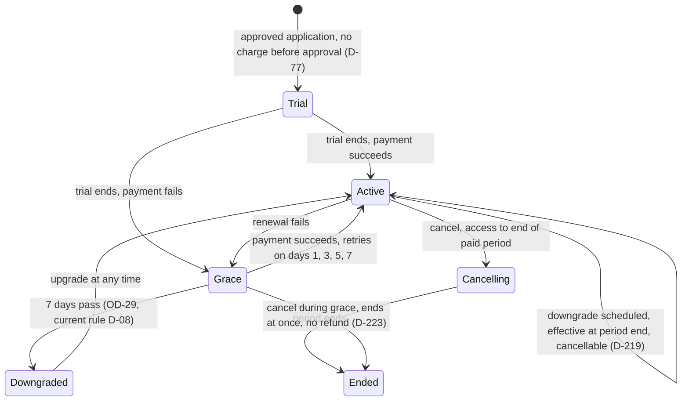

Plans renew themselves, chase their own payment, and schedule their own demotions. Failed charges retry on days 1, 3, 5 and 7 with an email each time; a seven-day grace period follows; downgrades wait for the cycle end and can be cancelled until then. This is the engine view of state machine 7.6 (Subscription); the traveler surface is [UF-TRV-10](/en/docs/user-flows/traveler#uf-trv-10-change-plan) and the shared plan-limit prompt is [UF-SHR-06](/en/docs/user-flows/shared#uf-shr-06-plan-limit-prompt).

**Delivery phase:** P5 Monetization and Gulf launch.

## Trigger and actors

- **Trigger:** a subscription charge attempt, a plan change, or the monthly counter reset.
- **Actors:** the billing product at the gateway; the dunning schedule; the reset job; admin overrides.

## Diagram

## Timers and rules

| Step | Timer (verbatim) | Rule trace |
|---|---|---|
| Dunning | "Failed charges shall retry on days 1, 3, 5 and 7, with an email at each attempt" | [FR-SUB-08](/en/docs/srs/requirements/sub#fr-sub-08--dunning), [FR-PAY-06](/en/docs/srs/requirements/pay#fr-pay-06--subscription-charges-and-dunning), D-09 |
| Grace | Grace lasts 7 days with features kept | [BRL-14](/en/docs/brd/requirements#7-business-rules), [FR-SUB-03](/en/docs/srs/requirements/sub#fr-sub-03--grace-period) |
| After grace | Post-grace behavior is [OPEN: [OD-29](/en/docs/brd/compliance#11-open-decisions)] (current rule D-08: drop to the basic tier, block new bookings and deals) | [OD-29](/en/docs/brd/compliance#11-open-decisions), D-08 |
| Upgrades | "A plan upgrade takes effect at once with proration" | [BRL-13](/en/docs/brd/requirements#7-business-rules), [FR-SUB-04](/en/docs/srs/requirements/sub#fr-sub-04--upgrade-downgrade-and-cancellation) |
| Downgrades | "a downgrade takes effect at the end of the cycle", cancellable before then | [BRL-13](/en/docs/brd/requirements#7-business-rules), [FR-SUB-04](/en/docs/srs/requirements/sub#fr-sub-04--upgrade-downgrade-and-cancellation), D-219, D-232 |
| Cancellation | "Cancellation keeps access to the end of the paid period. Cancelling during grace ends the plan at once with no refund" | [FR-SUB-04](/en/docs/srs/requirements/sub#fr-sub-04--upgrade-downgrade-and-cancellation), D-223 |
| Trials | "A trial-start notice goes on day 0 and reminders 3 days and 1 day before the end"; trial lengths are [OPEN: [OD-28](/en/docs/brd/compliance#11-open-decisions)] | [FR-SUB-07](/en/docs/srs/requirements/sub#fr-sub-07--trials), D-231, [OD-28](/en/docs/brd/compliance#11-open-decisions) |
| Counter reset | "at 00:00 on the 1st of each month in the owner's time zone" | [FR-SUB-10](/en/docs/srs/requirements/sub#fr-sub-10--counter-reset), D-218 |
| After downgrade | Over-limit items keep working; new actions hit the limit gate | [FR-SUB-09](/en/docs/srs/requirements/sub#fr-sub-09--limits-after-a-downgrade), D-144 |
| Admin override | Second admin plus end date required; owner emailed; auto-reverts at the end date | [FR-SUB-05](/en/docs/srs/requirements/sub#fr-sub-05--admin-overrides), D-227, D-230 |
| Limit gate | Server-side gate returns the plan, the limit and the next tier; the plan service fails closed | [FR-SUB-02](/en/docs/srs/requirements/sub#fr-sub-02--feature-gates), [FR-SUB-11](/en/docs/srs/requirements/sub#fr-sub-11--plan-service-failure), D-224 |

## Stories

- **As a plan owner**, I want four spaced retries with an email each, so that one empty card does not end my service. *([FR-SUB-08](/en/docs/srs/requirements/sub#fr-sub-08--dunning), D-09)*
- **As a plan owner**, I want a downgrade to wait for the cycle I paid for, so that I keep what I bought until it ends. *([BRL-13](/en/docs/brd/requirements#7-business-rules), D-219)*
- **As an admin**, I want overrides to carry an end date and a second approver, so that a favor never becomes a leak. *([FR-SUB-05](/en/docs/srs/requirements/sub#fr-sub-05--admin-overrides), D-227)*
- **As an organization owner**, I want counters to reset on my calendar's first of the month, so that quota math matches my books. *([FR-SUB-10](/en/docs/srs/requirements/sub#fr-sub-10--counter-reset), D-218)*
