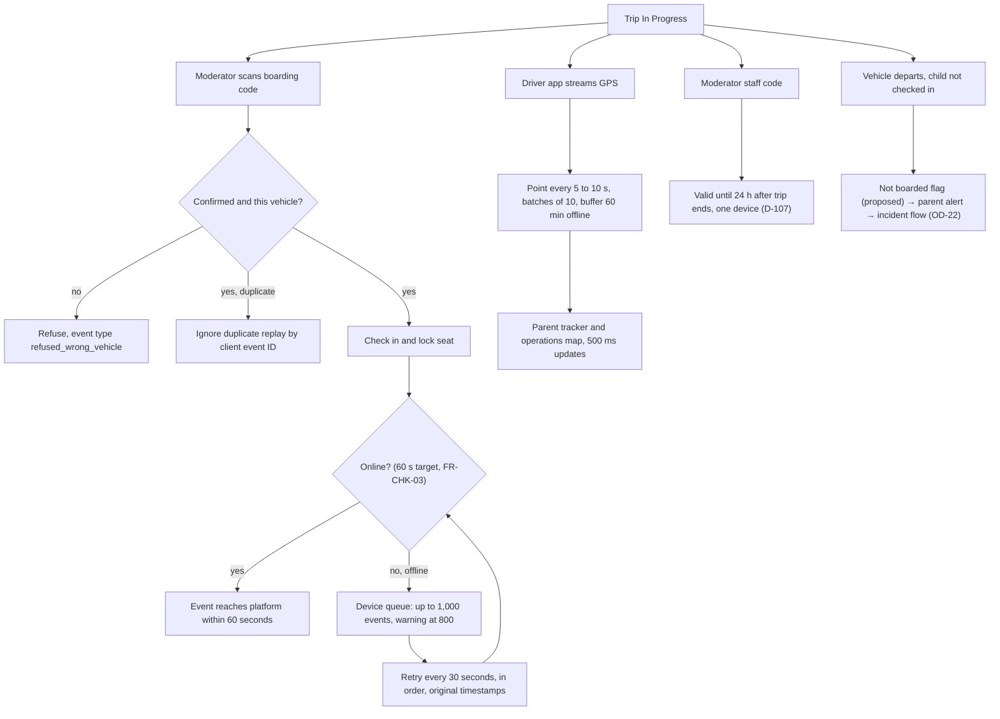

Trip day is a machine between people: boarding codes scanned against the right vehicle, check-in events pushed within a minute, a device queue that survives dead zones, GPS points every 5 to 10 seconds, and moderator access that ends 24 hours after the trip does. The moderator side is [UF-MOD-04](/en/docs/user-flows/moderator#uf-mod-04-check-in-a-passenger); the traveler side is [UF-TRV-08](/en/docs/user-flows/traveler#uf-trv-08-trip-day).

**Delivery phase:** P3 Operational depth.

## Trigger and actors

- **Trigger:** the trip reaches In Progress.
- **Actors:** the moderator's device; the check-in service; the driver's GPS stream; parents and operations watching.

## Diagram

## Timers and rules

| Step | Timer (verbatim) | Rule trace |
|---|---|---|
| Check-in delivery | "reaches the platform within 60 seconds" | [FR-CHK-03](/en/docs/srs/requirements/chk#fr-chk-03--event-record), [BR-CHK-03](/en/docs/brd/requirements#69-check-in-moderators-and-tracking-chk-mod-trk) |
| Offline queue | "queue on the device (up to 1,000; warning at 800), retry every 30 seconds… with original timestamps"; duplicates ignored by client event ID | [FR-CHK-05](/en/docs/srs/requirements/chk#fr-chk-05--offline-queue), D-117 |
| GPS cadence | "send a point every 5 to 10 seconds only while the trip is In Progress, batching up to 10 points per request and buffering up to 60 minutes offline" | [FR-TRK-02](/en/docs/srs/requirements/trk#fr-trk-02--location-collection), D-34, D-121 |
| Map freshness | map update "within 500 ms" | [FR-TRK-01](/en/docs/srs/requirements/trk#fr-trk-01--live-vehicle-location), [FR-SEAT-02](/en/docs/srs/requirements/seat#fr-seat-02--live-seat-map) |
| Moderator code | "valid until 24 hours after the trip ends, on one device at a time" | [FR-MOD-05](/en/docs/srs/requirements/mod#fr-mod-05--moderator-sign-in), [FR-MOD-03](/en/docs/srs/requirements/mod#fr-mod-03--access-revocation), D-107, D-108 |
| End of trip | End event to parents and operations; occupancy real-time during the trip | [FR-TRK-06](/en/docs/srs/requirements/trk#fr-trk-06--end-of-tracking), [FR-CHK-07](/en/docs/srs/requirements/chk#fr-chk-07--occupancy) |
| Traveler privacy | Travelers never see live position or ETA | [FR-TRK-07](/en/docs/srs/requirements/trk#fr-trk-07--no-live-position-for-travelers), [BRL-29](/en/docs/brd/requirements#7-business-rules), D-317 |
| No-show | Not a formal state; departure without check-in raises the proposed "not boarded" flag and the incident flow replaces cancellation | [OD-22](/en/docs/brd/compliance#11-open-decisions), D-25, parent tracker proposals |
| End-of-trip report | Moderator report with headcount and mismatch reason, read-only after submit | [FR-MOD-02](/en/docs/srs/requirements/mod#fr-mod-02--end-of-trip-report), [FR-MOD-06](/en/docs/srs/requirements/mod#fr-mod-06--report-lock) |
| Tracking data scope | Raw GPS kept 90 days, then an hourly summary; scope limited to the trip | [FR-TRK-05](/en/docs/srs/requirements/trk#fr-trk-05--tracking-data-scope) |
| Child data | Child-data restrictions apply to tracking, history and reports | [FR-PAR-05](/en/docs/srs/requirements/par#fr-par-05--child-data-restrictions) |
| Moderator assignment | A moderator is assigned per vehicle with a phone number before publish | [FR-STF-05](/en/docs/srs/requirements/stf#fr-stf-05--moderator-assignment) |
| Re-board | Re-board at a stop allowed (proposed) | [FR-CHK-04](/en/docs/srs/requirements/chk#fr-chk-04--check-out-at-stops), sections 7.2 and 7.3 |

## Stories

- **As a moderator**, I want check-in to work in a dead zone and sync later in order, so that a weak signal never loses a passenger. *([FR-CHK-05](/en/docs/srs/requirements/chk#fr-chk-05--offline-queue), D-117)*
- **As a parent**, I want the map to update in half a second, so that I can see the bus reach the gate. *([FR-TRK-01](/en/docs/srs/requirements/trk#fr-trk-01--live-vehicle-location))*
- **As an operations controller**, I want GPS buffering for an hour of offline driving, so that tunnel sections do not create gaps. *([FR-TRK-02](/en/docs/srs/requirements/trk#fr-trk-02--location-collection), D-121)*
- **As an organization**, I want moderator access to expire a day after the trip, so that a seasonal staff code is never a standing key. *([FR-MOD-03](/en/docs/srs/requirements/mod#fr-mod-03--access-revocation), D-107)*
