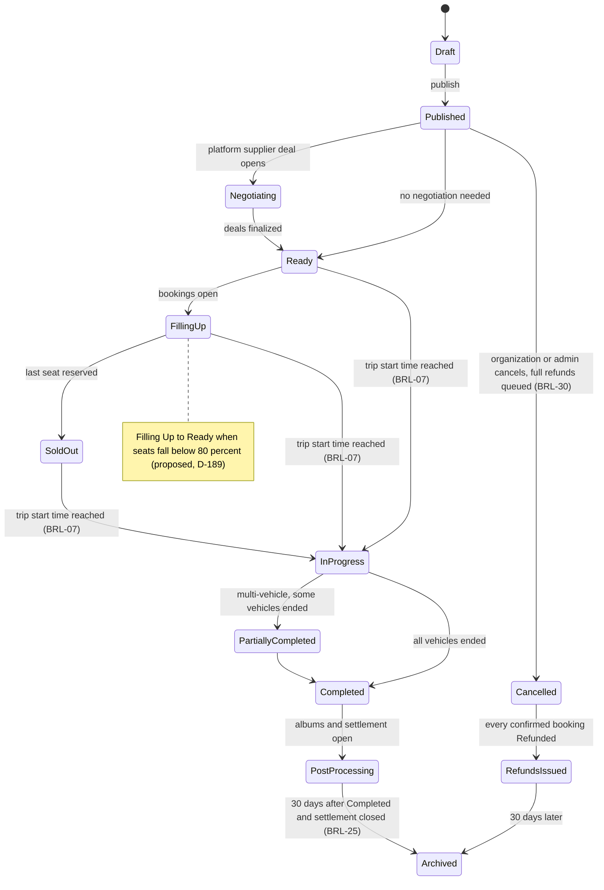

A trip moves through thirteen states from Draft to Archived, and several transitions belong to the system, not to any person: start time reached, settlement closed, thirty days passed. This is the engine view of state machine 7.1; the organization side is [UF-ORG-06](/en/docs/user-flows/organization#uf-org-06-create-a-trip-wizard).

**Delivery phase:** P2 (creation and booking), P3 (multi-vehicle and programs), P6 (tracking-era archival).

## Trigger and actors

- **Trigger:** an organization publishes a draft, the clock reaches departure, or the last booking completes its lifecycle.
- **Actors:** the organization; the start-time job; the remedy window; the archive job; travelers choosing remedies.

## Diagram

## Timers and rules

| Step | Timer (verbatim) | Rule trace |
|---|---|---|
| Start transition | "Trip start time reached; trip is Ready" moves the trip to In Progress | [BRL-07](/en/docs/brd/requirements#7-business-rules), section 7.1 |
| Remedy window | The traveler has "7 days to choose; then the case goes to admin"; remedy status offered, chosen, escalated, expired | [BRL-24](/en/docs/brd/requirements#7-business-rules), [FR-TRIP-06](/en/docs/srs/requirements/trip#fr-trip-06--changes-that-affect-confirmed-bookings), D-148 |
| Change notice | "Vehicle, driver or time changes are notified within 1 hour" | [FR-NTF-07](/en/docs/srs/requirements/ntf#fr-ntf-07--trip-reminders-and-change-notices), D-186 |
| Organization cancel | "every confirmed booking is refunded in full, with coupon redemptions reversed" | [BRL-30](/en/docs/brd/requirements#7-business-rules), [FR-BKG-06](/en/docs/srs/requirements/bkg#fr-bkg-06--organization-cancellation-of-a-trip), D-150 |
| Settlement gate | The trip archives "30 days after Completed, and only once its settlement is closed" | [BRL-25](/en/docs/brd/requirements#7-business-rules), [FR-ACC-10](/en/docs/srs/requirements/acc#fr-acc-10--archive-after-settlement), D-26 |
| Refunds-issued terminal | Cancelled becomes Refunds Issued when "Every confirmed booking Refunded", then Archived "30 days later" | section 7.1 |
| Ready gate | A trip is Ready when staffing is complete; finalized deals assign platform suppliers and drivers see their assigned trips | [FR-STF-01](/en/docs/srs/requirements/stf#fr-stf-01--driver-tracks), [FR-STF-03](/en/docs/srs/requirements/stf#fr-stf-03--ready-gate), [FR-STF-04](/en/docs/srs/requirements/stf#fr-stf-04--assignment-after-finalized-deal) |
| Program changes | Programs changeable until departure; later changes become traveler remedies | [FR-TRIP-04](/en/docs/srs/requirements/trip#fr-trip-04--program-changes-until-departure) |
| Publish gates | Drafts and targeted trips are hidden from browsing; VIP early access windows apply before public | [FR-TRIP-02](/en/docs/srs/requirements/trip#fr-trip-02--draft-public-and-targeted-publishing), [FR-TRV-02](/en/docs/srs/requirements/trv#fr-trv-02--trip-visibility-and-early-access) |

## Stories

- **As an organization**, I want the trip to start itself at departure time, so that no one has to press a button mid-operation. *([BRL-07](/en/docs/brd/requirements#7-business-rules))*
- **As a traveler affected by a change**, I want seven days to pick my remedy before anyone decides for me, so that a schedule change stays my call. *([BRL-24](/en/docs/brd/requirements#7-business-rules), [FR-TRIP-06](/en/docs/srs/requirements/trip#fr-trip-06--changes-that-affect-confirmed-bookings))*
- **As a finance operator**, I want archival gated on settlement closure, so that nothing disappears while money is still open. *([BRL-25](/en/docs/brd/requirements#7-business-rules), [FR-ACC-10](/en/docs/srs/requirements/acc#fr-acc-10--archive-after-settlement))*
- **As a parent**, I want vehicle or driver changes told to me within the hour, so that I am never surprised at pickup. *([FR-NTF-07](/en/docs/srs/requirements/ntf#fr-ntf-07--trip-reminders-and-change-notices), D-186)*
